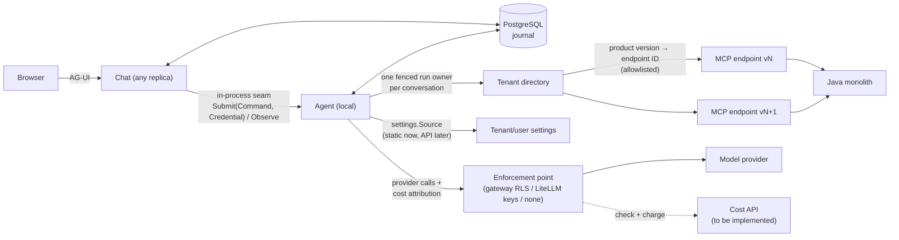
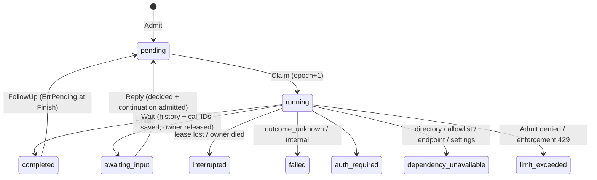
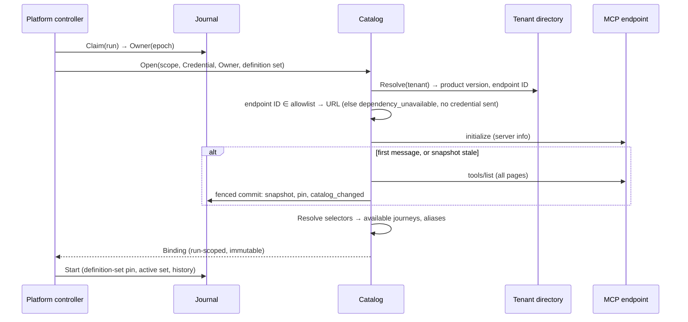
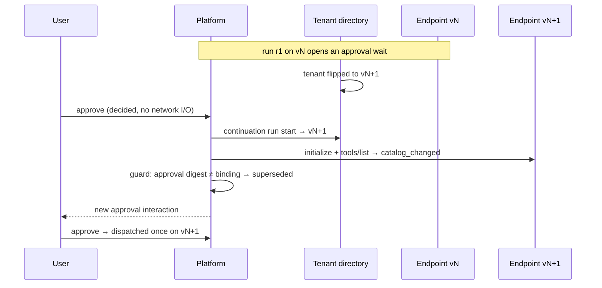
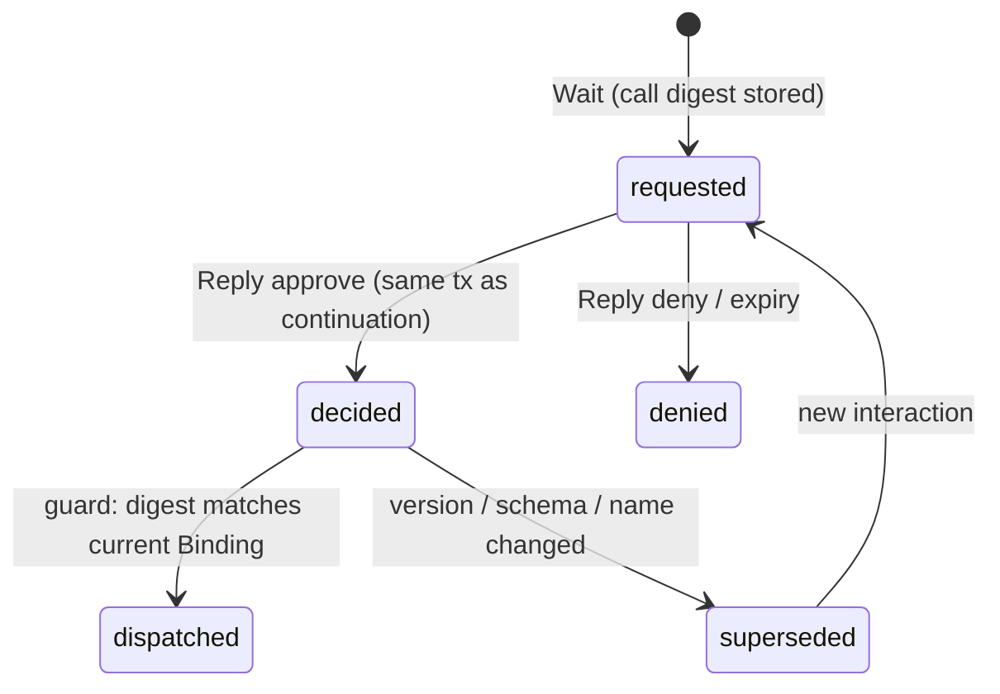
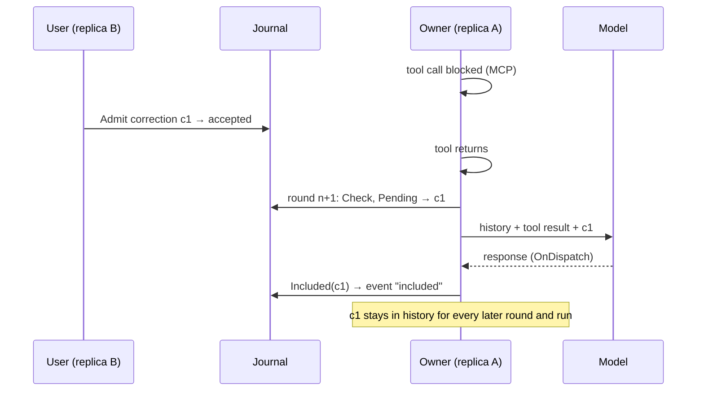
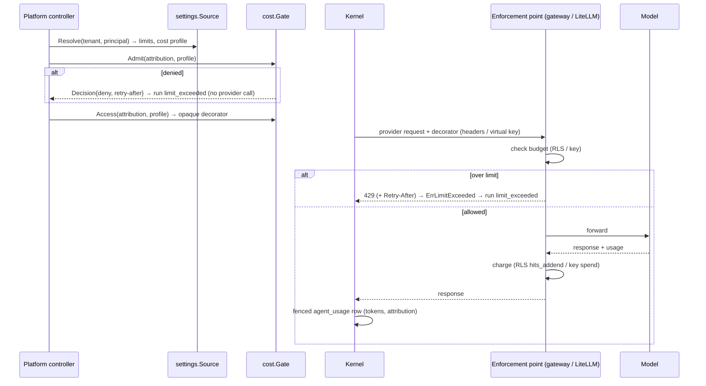

# Conversation-Agent Platform Design

Status: **approved design (single conversation agent, operation-key tool selection, catalog snapshots, product-version axis, 2026-10-17/18), plus the settings and cost seams (2026-10-18).** This document describes the end state of `github.com/swiftdiaries/az-agent-platform-go`. How the existing code gets there is in [migration.md](migration.md). Domain terms are defined in [CONTEXT.md](../CONTEXT.md).

The earlier hub-and-spoke design under `docs/superpowers/` is historical and superseded.

## Purpose

Replace the technology-debt LangGraph/chat backend with a small Go service. The Java monolith remains the source of business capabilities and exposes them as MCP tools.

The service has two deep modules:

- **Chat** owns the AG-UI input and event-delivery boundary, external conversation identity, and the user-facing projection.
- **Agent** owns the conversation agent, journey activation, the conversation history, model context construction, tool catalog resolution, tenant/user settings, cost attribution, and MCP tool calls.

They communicate through a narrow in-process interface. A journey is configuration, not a new framework abstraction or a separate agent. It has a stable name, instructions loaded on demand (a `SKILL.md` bundle), a tool selector over server-published operation keys, a policy overlay, and supporting files. MCP owns each tool's name and schema, and both may differ per tenant, user and product version. One conversation agent per thread activates journeys as needed and receives corrections at safe points.

## Confirmed needs

- A Go agent platform replaces the existing LangGraph/chat backend.
- The platform stays general purpose and independent of product, journey and MCP tool schema. Vacation planning and shift-swap self-service are reference journeys only.
- The Java monolith exposes business operations over MCP.
- Chat is a deep module with AG-UI as its UI input seam. Agent is a separate deep module called in-process by Chat.
- Conversation threads persist so a user can return later. Context persists across turns in one conversation history, and several journeys may be active in it at once. Persistent context does not mean a run is active.
- V1 supports reconnecting to a still-running turn as well as resuming an idle saved conversation.
- V1 runs as a Kubernetes Deployment and Service with multiple replicas. Any replica accepts UI requests; sticky sessions are not required.
- Java MCP calls run with the current user's permissions, from UI-supplied headers validated by the existing product auth integration.
- Traces correlate work across Chat, Agent, model calls and MCP tools.
- Each declarative journey defines instructions, a tool set and supporting files.
- One conversation agent per thread activates journeys. The meaning of the product's current "slots" is not specified and is not assumed to mean concurrent or addressable agent instances.
- While the conversation agent is running, a user correction is accepted and delivered, with existing context, at the next safe point.
- Tool names are dynamic per tenant and per user. Each journey has an associated tool set, expressed without tenant-specific names.
- The user's MCP `tools/list` result is captured and cached when a conversation's first message is handled.
- Tenants run different product versions. The MCP server ships in step with the product, so each product version has its own MCP endpoint, and a tenant directory maps each tenant to its product version and endpoint. Several product versions are supported at once.
- The Java MCP server publishes `_meta` on its tools.
- Most journeys can ask structured clarification questions and request explicit action approval. A durable wait may span pod replacement and hours or days, then resume the same pinned conversation on any replica without repeating completed tools.
- **Tenant and user settings** that an API can later supply. `max_active_journeys` is the first such setting.
- **A cost API** whose enforcement sits outside the platform (an Envoy RLS service, a Linkerd-based RLS service, or LiteLLM virtual keys per tenant and per user, possibly in front of a gateway such as agentgateway). The platform builds and tests the seams now; the mechanism behind them is chosen later.

The steering requirement does **not** promise cancellation of a running model call or tool. A correction is delivered at the next provider request; it cannot undo a tool that is already running.

## Decisions

### Addressing and conversations

- **No hub or router.** Every message goes to the conversation's one conversation agent, which streams directly to the user. There is no routing model call and no handoff between agents.
- **One history per thread.** The conversation row holds the retained history, the active set and the definition pin. There is one session per conversation, not one per journey.
- **Explicit target.** A message may carry an optional stable journey ID, which activates that journey deterministically before the run. Otherwise the agent sees metadata for the journeys available to this user and activates them by calling `activate_journey`. The UI adapter parses mention syntax into the target ID; Agent does not parse presentation syntax.
- **Instructions** come from the active set on every request. They are never stored in transcript history, so compaction cannot lose them.

### Definitions

- Journey definitions are versioned files compiled at startup into a **definition set**, identified by a digest. A conversation pins one set digest; new conversations use the current one. The `agent_definition_current` pointer is a single row.
- The set identifies each journey's instructions, tool selector and policy overlay. It does not identify the tools a given user can reach (those come from the user's catalog snapshot at that user's product version), and it does not freeze behaviour behind an external model or MCP server.
- Journey instructions are immutable `SKILL.md` packages: metadata is available for selection, and instructions and configured supporting files load on demand. Executable actions are MCP tools, never skill scripts. Runtime skill installation, arbitrary file access and shell execution are outside this contract.
- Definition sets are immutable after startup. There is no in-process activation API or hot reload.

### State and credentials

- PostgreSQL stores conversation commands, history, catalog snapshots, run state and sequenced reconnect events. Object-store snapshots are deferred to future asynchronous long-running workflows. The V1 recovery boundary is idle resume and live reconnect; automatic execution recovery after process death is deferred.
- The UI supplies the current user's auth headers on each request. The Chat auth adapter validates the existing product auth context and passes a request-scoped `Credential` to Agent. Credentials live only in the owning run's memory and are applied to MCP requests for that run; they never enter a journey definition, history, durable inbox, event, trace or log. A steering or reconnect request through another replica authorizes the same thread principal and persists only its nonsecret command. An idle or new run requires fresh ingress auth.
- If credentials expire mid-run and no current authorized carrier is available to the owner, the run ends `auth_required`. The platform does not store refresh tokens.
- The tenant is part of the command. Chat exposes it from the authenticated identity; Agent never infers it from a header.

### Tools, catalogs and versions

- **Tools are selected by `_meta` operation key, never by name.** Java owns the keys, tags and annotations. The platform owns the selectors and a policy overlay that can only narrow. The model sees stable aliases.
- **Catalog snapshots** are raw paginated `tools/list` descriptors captured at the first message. They are immutable, addressed by digest, stored per principal, and each conversation pins one. They are revalidated at run start and are never authorization.
- **Product versions.** A tenant directory maps tenant to product version to endpoint ID, and the endpoint is allowlisted before any credential is sent. A support window and per-version CI fixtures guard compatibility.
- **Error encoding.** Business, entitlement and validation rejections become model-visible results. Only `outcome_unknown`, `auth_required` and internal failures are errors.

### Human interaction

- **Approval markers:** requested, decided (at reply, no network I/O), dispatched (at the guard), denied, superseded (when the catalog or version changed).
- Clarification supplies information only. Approval is a one-time decision bound to an exact call. Neither can be manufactured by model text.

### Settings and cost

- **Settings** are resolved from a `settings.Source` port, layered default, tenant, user, with a user value able only to narrow. They are typed, digest-versioned, and resolved once at run start.
- **The active-journey limit is per tenant** (`max_active_journeys`).
- **Cost enforcement is outside the platform.** The platform owns attribution, typed outcomes and a usage record; the enforcement point owns budgets, counting and pricing.

## Design deltas from the original spec

The original hub-and-spoke spec assumed a Microsoft Agent Framework (MAF) kernel. This design departs from it where the existing code and later decisions require.

| Topic | Original spec | This design |
|---|---|---|
| Tool loop | MAF `agent.Run` segments, `activate_journey` as a non-invocable tool, a forked MAF with `Config.ProviderMiddlewares`, an exported `mcptool.NewTool` | The product owns the loop (see [Product-owned tool loop](#product-owned-tool-loop)). No MAF fork, no `ProviderMiddlewares`, no exported `mcptool.NewTool` |
| Steering | A Transcript boundary middleware replaces `MessageInjector` | The existing inbox: `Store.Pending` each round, `OnDispatch` calls `Store.Included` |
| Calls to inactive tools | MAF's native not-found path | The dispatcher returns `{"error":"tool_not_active"}` as a nil-error result and never dispatches |
| Active journeys | At most 2 | At most N, set per tenant (`max_active_journeys`, default 2, allowed 1 to 4) |
| Settings | none | A `settings.Source` seam (tenant and user) |
| Cost | none | A `cost.Gate` seam, `Attribution`, `limit_exceeded`, `agent_usage` |
| Retry/approval classes | read-only or idempotent | `read_only`, `idempotent`, `effectful`; approval unless `read_only` |
| Provider skill inputs | Skill catalog and material passed to providers | Providers read only the composed instructions |
| `outcome_unknown` scope | A later run may proceed with the uncertainty surfaced | The thread-level stop at run start is kept for V1; the journey pin is also recorded |
| Cross-journey context | Not applicable | Removed: one history per thread has no "selected context" from another journey |
| Supporting files | On-demand | `load_skill` is removed; `read_skill_resource` stays, scoped to active journeys |
| Definition config | Not specified | Real YAML, strictly decoded |

## Approach: product-owned tool loop

TARGET already owns its model/tool loop. `internal/runtime` `runHarness` runs up to **16 rounds**. Each round makes **one provider call**, and the product dispatches the tools itself. A bare MAF `agent.New(ProviderConfig{Run: ...})` is only the one-provider-call adapter: it is **rebuilt each round** from the active set's tools and instructions. The Foundry adapter disables SDK iteration (`MaximumIterationsPerRequest=0`).

Consequences:

- **No MAF fork.** The design needs no `Config.ProviderMiddlewares` and no exported `mcptool.NewTool`.
- **Gating is in the dispatcher.** The dispatcher rejects any tool that is not in the active set, so the gate fails closed regardless of what the model asks for.
- **Steering already works.** `Store.Pending` drains the inbox every round, and `OnDispatch` calls `Store.Included` after the provider accepts the request. A correction stays in history for every later request.
- **Activation needs no run segments.** The next round rebuilds the inner agent with the new active set.

Alternatives considered and not taken:

- **Stock MAF composition** (a hub agent with journey agents as tools). It returns a string per query and gives no durable subagent session, mailbox or approval path.
- **A hub with a persistent session per journey.** It adds a routing model call and a misrouting risk on follow-up turns ("yes, the second option"), copies lossy context across handoffs, serves one specialist at a time (a message spanning two use cases must be split), and was never qualified as two sessions per conversation. The dynamic per-user catalog fits catalog-derived journey availability better than pre-bound journey agents.
- **MAF run segments with a forked provider middleware.** It was the original plan. The product's own loop makes it unnecessary.

The cost of one conversation agent is a growing transcript and possible instruction bleed between active journeys. These are handled by the active-set cap and a context-budget policy (see [Open questions](#open-questions)).

### Reference synthesis

| Reference | Adopt | Defer |
|---|---|---|
| Codex | Durable per-worker identity, typed inbox plus explicit wake, command/event port, privacy-safe correlation | Arbitrary agent tree and path routing, capacity and residency machinery |
| [Agent Skills](https://www.anthropic.com/engineering/equipping-agents-for-the-real-world-with-agent-skills) and [tool search](https://www.anthropic.com/engineering/advanced-tool-use) | Metadata-first journey selection; few advertised tools per request | `find_tools` search over the snapshot, unless a journey exceeds `max_tools` |
| deepagents subagents | Nothing in V1 | Ephemeral read-only research subagents, only after measured need. Restart-on-steer is unsafe for effectful tools |
| Pi | Admission separate from drive, one serialized mutation line, durable correction IDs with separately observed inclusion, open-operation identity, snapshot plus ordered events | Multi-lane, fork and plugin machinery |
| Kagent | A portable journey declaration separated from runtime, compile-then-run validation, immutable digests, credentials outside declarations. A selector that resolves to nothing fails closed (the reverse of Kagent's default) | CRDs, controllers, recursive agent topology |
| Substrate | Only the future lesson that immutable payloads precede a manifest commit | Object-store snapshots for conversations |

## Module map

Only the ports below are interfaces with more than one adapter. Everything else is a concrete type, so there are no Compiler, Router, SelectorResolver or SnapshotStore interfaces.

| Module | Package | Responsibility |
|---|---|---|
| Platform controller | `internal/platform` | `Submit(ctx, Command, credential.Credential)` and `Observe`. Claim and lease, run-start ordering, wake and follow-up, interruption. `Command` carries `Tenant` |
| Journal | `internal/journal` | Concrete PostgreSQL store, one method per transaction. Conversation state (history, active set, pins), catalog snapshots, approval markers, usage rows, database-clock fencing, admission/finish race |
| Definitions | `internal/definitions` | `definitions.Set`: strict YAML, selectors, overlays, version ranges, `SKILL.md` references, digests. No routing |
| Catalog and Binding | `internal/catalog` | `Open(ctx, scope, cred, owner, set) (*Binding, error)`: directory, allowlist, `initialize`, revalidation, paginated listing, snapshot commit. Pure `Resolve(journey, snapshot, metaKey) Resolution`. Aliases, collision checks, guard, retry, classification |
| Journeys | `internal/journeys` | Pure logic: active set, LRU, pinning, `Fit`, instruction composition. `internal/skills` keeps `SKILL.md` bundle reading |
| Transcript | `internal/journal` inbox and `internal/runtime` | `Pending`/`Included`, history. Regression-guarded |
| Kernel | `internal/runtime` | `runHarness`, per-round inner agent, dispatcher, `activate_journey`, `request_user_input`, `read_skill_resource` |
| Settings | `internal/settings` | `Source` port: static file, mutable (tests); an API adapter is left room for |
| Cost | `internal/cost` | `Gate` port: `Open`, `Headers`, `Scripted`; `Attribution`, `Decision`, `Access`, `Usage` |
| Credential | `internal/credential` | Opaque, self-redacting `Credential`. A leaf package, so the catalog can import it |
| Tenant directory | `internal/tenantdir` | `Directory` port: static YAML, mutable (tests); `Allowlist`; an HTTP adapter waits for the directory API |
| Providers | `internal/provider/{litellm,foundry}` | Model adapters that apply `Access`, classify 429s and return `Usage` |
| Chat | `internal/chat` | AG-UI, authentication and tenant extraction, event mapping |
| Telemetry | `internal/telemetry` | Typed attribute helpers accepting only opaque IDs; redaction span processor |

The ports are `tenantdir.Directory`, `settings.Source`, `cost.Gate`, Chat's auth (product and test), and `runtime.Model` (vendor and scripted stub). Test support packages are `internal/mcptest` (controllable MCP servers), `internal/modeltest` (a scripted model and a scripted OpenAI-Responses server) and `internal/pgtest` (PostgreSQL 16).

Human interaction is not a separate module: it is Journal `Wait`/`Reply`, the kernel's wait outcome, and Binding's dispatch guard.

## Ownership and seams



### Chat

Chat owns:

- AG-UI request validation, the authentication and authorization handoff, and mapping external IDs to internal opaque IDs;
- the user-facing projection of accepted user messages, visible agent messages and Agent-owned execution states;
- delivery cursors and a rebuildable event replay projection for reconnecting to a still-running turn;
- translating Agent events into AG-UI events, including `dependency_unavailable` and `limit_exceeded`;
- validating every submit, steer and reconnect request against the thread principal, and building the `Credential` from the configured header names.

Because live reconnect is required, Chat owns the hosting and re-attachment policy while Agent keeps the run alive independently of any HTTP connection.

### Agent

Agent owns:

- loading and validating journey declarations into definition sets;
- the conversation agent and journey activation, without assigning semantics to the product's current slots;
- one retained history per conversation;
- resolving the tenant's product version, endpoint and settings; capturing and revalidating the user's catalog snapshot; binding selectors to that catalog;
- the authoritative append-only command and event journal: accepted inputs, inbox state, run state, visible outputs and tool outcomes;
- serialized inbox delivery and wake-up for steering messages;
- durable pending human interactions, one-time answer consumption and continuation checkpoints;
- tool-call policy and result normalization;
- cost attribution, the cost gate and usage rows;
- model, agent and tool spans;
- claiming one execution owner per conversation's active run across replicas, and fencing authoritative writes by ownership token.

Chat never writes a second authoritative copy of a command. Agent returns `accepted` only after the command and its unique communication ID commit to the journal. If the process stops between receipt and execution, the committed command stays pending.

One invariant closes the accept/run race: admission of a command and the transition of its conversation's active run to a terminal state are serialized in PostgreSQL (`Finish` returns `ErrPending`, which leads to a live-owner follow-up). While the owner lives, a run cannot become terminal while leaving a committed pending command without a scheduled follow-up. Every replica may append to the durable inbox; the owner reads it, with database notification only a latency hint. After owner loss, reopening surfaces the interrupted run and its pending commands; it does not automatically continue.

### Run ownership

Claim increments the owner epoch. The owner checks the epoch and lease, against the database clock, before each provider or MCP dispatch, after a tool returns, and on every owned write. A lease cannot stop an MCP request already sent to Java, prove its outcome, or prove the old pod dead. Lease loss marks the run `interrupted` and blocks automatic takeover of that run. V1 claims one authoritative database owner, not exactly one physical external action.

### The narrow in-process seam

```go
type Platform interface {
    Submit(context.Context, Command, credential.Credential) (Receipt, error)
    Observe(context.Context, Subscription) (Snapshot, EventStream, error)
}
```

`Command` carries an opaque thread ID, the authenticated principal and tenant, a unique communication ID, text or an interaction reply, an optional stable target journey ID, and whether idle work should be woken. `Credential` is the request-scoped carrier: an opaque type with unexported headers whose `String`, `GoString`, `Format`, `MarshalJSON` and `LogValue` all redact, so "credentials are never serialized" is enforced by type. `FromRequest(r, names)` copies only the configured header names, and `Apply(*http.Request)` is the only way to use one. It reaches only the owning run's Catalog and is never stored with the command.

`Receipt` reports **accepted/pending** after the authoritative commit. A later event may report **included in provider request** only when the provider boundary observed it. Neither means a correction was applied retroactively. `Subscription` re-attaches after a sequence cursor and first returns the current run snapshot plus retained later events.

Provider messages, MCP sessions, catalog descriptors and dynamic tool names stay private to Agent. Snapshots and events expose journey IDs, operation keys and aliases, never tenant-specific tool names.

## State

| State | Purpose | Authority | Recovery claim |
|---|---|---|---|
| Durable conversation | User messages, visible answers, history, active set, accepted steering, run status, recorded tool outcomes | PostgreSQL journal on the conversation row; Chat renders a projection | Return to an idle thread from any replica |
| Catalog snapshot | The user's tool descriptors (names, schemas, `_meta`, annotations) at one product version, plus digest and endpoint ID | PostgreSQL; immutable, addressed by digest, per principal, with a per-principal "latest" pointer; nonsecret | Each conversation pins one digest and revalidates at its own run start; never authorization |
| Settings | Resolved limits and cost profile for one run | Recorded on the run (digest plus applied values) | Reproducible record of what governed the run |
| Streaming history | Current run snapshot plus ordered domain events after a cursor | Sequenced PostgreSQL events; Chat encodes AG-UI | Live reconnect through any replica |
| Model context | Base prompt, available-journey metadata, active journey instructions, advertised tools, tool calls and results | Rebuilt by Agent for each provider call | Derived data; never the sole record |
| Human wait | Pending question or approval, pinned history and call identity, the answer or decision | PostgreSQL journal | Releases the owner; an authorized reply resumes on any replica without replaying completed tools |
| Usage | Per-model-call token usage with attribution | `agent_usage` rows, fenced writes | Read side for a future cost API |

Provider-facing messages are rebuilt from stable product records; internal framework objects are not the schema. PostgreSQL commits each command and its accepted event once by communication ID. Every visible domain event gets a per-conversation monotonic sequence in the same transaction as its state transition. Reconnect reads a snapshot at watermark `H`, then events with `seq > H`; notifications only wake the reader, and the query closes gaps. Clients deduplicate by sequence, so V1 does not claim exactly-once network delivery.

Run states:



A new terminal state always touches four places: the allowed states in `Finish`, the `agent_commands.terminal_reason` CHECK, the event mapping in `journal/observe.go`, and Chat's mapping.

## Conversation agent and journeys

- **What the model sees.** Metadata (name and description) for the journeys **available to this user**. A journey is available when every required operation resolves in the user's snapshot and the tenant's product version is in its range.
- **What a journey is.** A `SKILL.md` bundle, a selector, an overlay and a product-version range. A platform-level `configs/conversation.md` supplies the base prompt; the per-journey system prompt is the `SKILL.md` body.
- **Activation.** `activate_journey{journey}` is dispatched by the runtime. It validates availability, makes a fenced write of the active set, and answers with a short acknowledgement. Any other calls in the same response are answered "not executed; call again after activation", so the history stays well-formed. An explicit target activates its journey before round 0.
- **Next round.** The inner agent is rebuilt with the active journeys' alias tools plus `request_user_input`, `activate_journey`, and `read_skill_resource` (only when the active journeys have supporting files). Instructions are the base prompt, the available-journey metadata, and the active journeys' `SKILL.md` bodies.
- **Calls to inactive tools** return `{"error":"tool_not_active"}` as a nil-error result. They are never dispatched.

```mermaid
sequenceDiagram
    participant K as Kernel (runHarness)
    participant JN as Journeys (active set)
    participant AG as inner agent (one provider call)
    participant M as Model
    participant B as Binding
    K->>JN: compose(available metadata, active set)
    K->>AG: round n: tools = active aliases + built-ins
    AG->>M: request
    M-->>AG: activate_journey("vacation-planning") [+ sibling calls]
    AG-->>K: calls
    K->>JN: activate (settings limit N, LRU, pinning) → fenced journal write
    K->>K: ack result; siblings = "not executed"
    K->>AG: round n+1: rebuilt with new active set's tools + instructions
    AG->>M: request
    M-->>AG: call leave_balance (alias)
    K->>B: Call(alias) → remote name (lease → guard → retry → classify)
    B-->>K: result
    K->>AG: round n+2
    AG->>M: request
    M-->>AG: final answer
```

### Active set and the per-tenant limit

- At most **N** journeys are active, where N is the tenant's `max_active_journeys` (default 2, allowed 1 to 4). The cap bounds the tools in one request to N times `max_tools`.
- Activating beyond N evicts the least recently used **unpinned** journey. V1 has no model-facing deactivate tool.
- A journey with a pending approval or an unresolved `outcome_unknown` operation is **pinned** and is never evicted.
- If all N active journeys are pinned, a further activation is refused, and the refusal is returned to the model as the activation's tool result.
- A user-level setting may narrow the tenant's limit (for example to 1) but never raise it.
- **Lowering a limit mid-conversation:** the next run start evicts unpinned journeys (LRU first) down to the new limit. Pinned journeys are never evicted, and activations are refused until the set is below the limit.
- The active set persists in `Wait` and `Finish`, so it survives owner changes and restarts.
- The limit always comes from the run's resolved `Settings`, never from journey configuration.

The `internal/journeys` logic is pure: `ActiveSet.Activate(id, limit, pinned)`, `Fit(limit, pinned)` and `Compose(base, available, active)`.

## Tool catalog and operation keys

Tool names are dynamic per tenant and user, so a journey never names a tool.

- **Java owns facts.** Each tool's `_meta` carries a namespaced, stable **operation key** (for example `com.example/operation: leave.request`) naming the operation's semantic contract, plus optional tags. MCP `annotations` carry side-effect hints. A breaking contract change gets a new key (`leave.request` becomes `leave.request.v2`) and `_meta` may mark the old one deprecated. Additive schema changes keep the key. `_meta` describes what a tool *is*, never which journey uses it, so a new journey never needs a Java release. The `_meta` key name is set in config (`catalog.operation_meta_key`) because it is an integration input.
- **The platform owns selection policy.** A selector names operation keys (alternatives in preference order), or tags narrowed by hints. The overlay can only narrow.
- **Java owns exposure.** A tool the user may not call never appears in their `tools/list`, and Java authorizes every `tools/call` with the forwarded user credential.

### Resolution

At run start, Catalog resolves every journey's selector against the snapshot:

- A required operation that matches zero tools, or more than one, makes the journey **unavailable** to this user, with a typed reason. It is hidden from the metadata the model sees, so it never fails mid-turn.
- A resolved set larger than `max_tools` makes the journey unavailable.
- Name normalization and collision checks run per journey, after filtering. One tenant's oddly named tool cannot disable unrelated journeys.

### Aliases

The model sees a stable alias derived from the operation key (for example `leave_balance`), never the dynamic name. Binding maps each alias to the user's remote name at call time, using the **remote** name as the server knows it, so names with characters outside `[A-Za-z0-9_.-]` (such as `/`, a space or `:`) are called correctly. Descriptions and input schemas come from the server. This keeps skill text, evals and the provider prompt cache stable across tenants and avoids provider name-length and character limits.

### Catalog snapshots

- **Contents:** raw descriptors (name, description, schemas, `_meta`, annotations), a digest, the product version and the endpoint ID. Never bound tool objects. The rows are nonsecret.
- **Scope:** immutable and addressed by digest, stored per `(tenant, principal, product version, endpoint ID)`, with a per-principal "latest" pointer. Each conversation pins one digest. One conversation's revalidation moves "latest" but never another conversation's pin. A per-tenant key would leak tools across users with different entitlements.
- **Capture:** on the first message, by paging `tools/list` to completion with the go-sdk's `ClientSession.Tools` iterator. MAF's single-page `ListTools` is not used.
- **Revalidation:** at each run start. It re-lists only when the product version, the server version from `initialize`, or the endpoint changed, or the TTL expired.
- **On change:** the run is claimed first, then `Catalog.Open` runs. One fenced commit then records the new snapshot, the conversation's new pin and a `catalog_changed` event (old and new digest and version) before the first dispatch.
- **Never authorization.** A revoked tool that is still in the snapshot fails at Java as an auth or business rejection, never `outcome_unknown`.



### Binding

A Binding is run-scoped and immutable, and owns the run's credentialed MCP session. Tools are descriptor-backed alias tools; `Binding.Tools(ids...)` returns the active journeys' tools, and `Binding.Call(alias)` sends the remote name. A call runs, in order:

1. lease check;
2. approval guard;
3. retry (overlay `read_only` and `idempotent` only), reusing the run's `guardedCall`;
4. outcome classification.

Business rejections, entitlement rejections, validation failures and MCP `isError` results are **nil-error results** the model sees. Only `outcome_unknown`, `auth_required` and internal failures are Go errors. Bound tools are never cached or shared across runs or principals.

## Product versions and MCP endpoints

The MCP server ships in step with the product. Each product version has its own MCP endpoint, and the **tenant directory** maps tenant to product version to endpoint. This axis is independent of the definition set, so a run records `(definition digest, product version, endpoint ID, catalog digest)`.

- **Directory.** `tenantdir.Directory.Resolve(tenant)` returns `{ProductVersion, EndpointID}`. Per-tenant behaviour settings live in `settings.Source`, not in the directory. A lookup failure is `dependency_unavailable` before any dispatch. Directory entries may be cached with a short TTL.
- **The endpoint is a credential destination.** The URL comes **only** from the deploy-time allowlist keyed by endpoint ID. The resolver returns an ID, the allowlist yields the URL, and the transport accepts only resolver-built endpoints. A directory entry naming a non-allowlisted endpoint fails closed with zero requests sent.
- **The handshake is the truth.** The server version from `initialize` is recorded with the run. A mismatch with the directory is recorded as an event, and the run uses the handshake's catalog. MCP protocol revision negotiation is a separate axis handled by the SDK.
- **Connections.** One HTTP transport pool per endpoint; the credential is applied per request. In-flight runs keep their endpoint and session until they finish, so product cutover must keep the old endpoint serving through a drain window.
- **Compatibility.** Each journey declares `product_versions` and relies on its required keys. A journey out of range for the tenant is unavailable, through the same fail-closed path as an unresolved selector. The support window is the current version plus the two before it (proposed). CI resolves every journey against a recorded `tools/list` fixture per supported version (`testdata/catalogs/<version>/tools.json`) and fails on unexpected unavailability, ambiguity, collision or `max_tools` overflow.
- **Upgrade or rollback mid-conversation:**
  - the next run re-lists, re-resolves and records `catalog_changed`;
  - history stays coherent through the aliases;
  - decided approvals become superseded, and clarifications survive;
  - `outcome_unknown` stays unresolved, and reconciliation must not assume the new version's semantics;
  - versions are not assumed to increase.



## Journey definition

The definition is real YAML, strictly decoded (`KnownFields(true)`) and compiled into a digest-addressed `definitions.Set`:

```yaml
catalog:
  operation_meta_key: com.example/operation   # integration input
journeys:
  - id: vacation-planning
    skill: skills/vacation-planning/            # SKILL.md: metadata + instructions (+ supporting files)
    product_versions: {min: "2026.2", max_exclusive: "2027.1"}
    tools:
      - op: leave.balance
      - op: [leave.request.v2, leave.request]   # alternatives in preference order
        approval: required                      # overlay may only narrow
      - tags: [leave]
        read_only: true
    max_tools: 15
```

The vacation label is illustrative. The platform schema has no vacation, shift, employee, balance, date or leave-approval fields; operation keys and tags are opaque strings. Those semantics live in skill documents and MCP tool schemas. `catalog.call_id_header` names the header that carries the opaque call ID to Java.

Startup validation:

- **Rejects** duplicate journey IDs, missing or escaping skill paths (no symlinks), malformed selectors, empty selector lists, unknown policy fields, and invalid product-version ranges.
- **Never validates tool names.** No tenant-independent name exists. Selectors are checked against per-version fixtures in CI instead.

Each journey's instructions are an immutable bundle rooted at a `SKILL.md`. Its frontmatter `name` and `description` are the metadata the model sees. Supporting files load on demand within the bundle only. Where prose must differ by product version, the bundle may contain a version-range overlay file; whole journeys are not forked per version.

**Rollout.** The compiled set is digest-addressed and additive. `AGENT_PLATFORM_RETAINED_CONFIGS` keeps pinned sets loadable. A pod becomes Ready only when it has every database-referenced pinned set plus the current one. The database marks a new set current only after the new replicas are ready. On graceful termination a pod fails readiness, stops new owner claims, and finishes its owned runs within the grace period without handoff. A forced stop leads to lease expiry and an interrupted run, not automatic continuation.

## Policy classes and approval

The policy overlay assigns each operation a class. The class is authoritative for approval and retry:

| Class | Retry | Approval |
|---|---|---|
| `read_only` | May retry transient failures | Not required, unless the overlay sets `approval: required` |
| `idempotent` | May retry for the same logical operation ID | Required |
| `effectful` | Never retried; an ambiguous outcome is `outcome_unknown` | Required |

(`idempotent` was named `deduplicated` in the earlier journal; it is renamed with the catalog migration.)

- **MCP annotations never grant `read_only`.** The class comes only from the reviewed overlay. The overlay can only narrow, so `approval: required` can add approval to a read-only operation but nothing can remove it.
- **The run computes `requires_approval`** from the class and the overlay, and the journal enforces it when an attempt begins: a first attempt that requires approval needs a consumed, matching approval.
- The operation key, alias and `requires_approval` are stored on each operation row. The remote name is not.

## Human waits and approvals

- **Clarification.** One to three questions, each with two or three described options, plus optional custom text. It supplies information only. A pending clarification survives a product-version change because it authorizes nothing.
- **Approval binding** is an immutable digest over the operation key, the resolved-name digest, the input-schema digest, the canonical arguments (`json.Number` preserved, trailing data rejected), and the product version, principal, conversation and definition-set digest. The server stores the call; client-supplied replacement calls are rejected.



- **Decided.** Set by `Reply` in the same transaction that validates the reply and admits the continuation. It does no network I/O, so any replica can handle it.
- **Dispatched.** Set in the `BeginAttempt` transaction when exactly one call whose digest matches the continuation's Binding goes out.
- **Superseded.** The continuation's `Catalog.Open` revalidates first. If the product version, schema digest or resolved name no longer matches, the guard marks the approval superseded and opens a new interaction instead of dispatching.

Denial, timeout, custom text and changed arguments never authorize anything. Business tools never interpret a clarification answer as approval, and no model text can manufacture an approval.

Entering `awaiting_input` is a deliberate safe checkpoint before an effectful dispatch: Agent persists the history and pending call IDs, commits the wait, releases the owner and ends the run. An authorized reply atomically consumes the interaction once and admits a continuation, which any replica can claim; completed tools are not replayed. The reply supplies fresh UI credentials, never serialized in the checkpoint. This guarantee is narrower than crash recovery: a pod that dies during a model or MCP call produces the interrupted/unknown semantics below.

## Steering

1. Chat submits user command `m1`. Agent atomically appends it, returns `accepted/pending`, and starts run `r1` independently of the HTTP request.
2. Agent resolves the product version, endpoint and settings, revalidates (or captures) the snapshot, and restores the conversation's history and active set. A journey is activated by explicit target or by the model.
3. The agent calls an advertised alias tool.
4. While that tool runs, correction `c1` is durably appended to the same inbox and returned `accepted/pending`. It may arrive on any replica.
5. The tool finishes and its result is appended to history. No claim is made that `c1` could cancel or undo it.
6. Before the next provider request, `Store.Pending` drains `c1` into the request. When the provider accepts the request, `OnDispatch` calls `Store.Included`, which records the `included` event. `c1` stays in history for every later round and run. If the run closed during acceptance, the follow-up turn is woken so the correction is not stranded.
7. Agent atomically commits the final output and terminal state, then emits the event.



## Effects, retry and errors

Every MCP call gets a stable opaque call ID. After a live transport failure where a write may have reached Java, the platform reports `outcome_unknown` and does not retry or report success. A retry is safe only for an operation the overlay classifies `read_only` or `idempotent` (see [Policy classes](#policy-classes-and-approval)).

- **Single retry owner.** The agent runtime owns retry. Model SDK retry stays disabled, or counts in the same budget. There is one retry budget per run, one logical operation ID per operation, and a distinct attempt ID per attempt.
- **Transient model failure:** may retry with bounded exponential backoff and jitter inside one total deadline. A limit rejection is never retried in-run.
- **Transient MCP failure:** retried only for `read_only` or `idempotent` operations. The Binding, not the model, owns those attempts.
- **Business rejection:** returned as a small structured result so the model can repair its arguments within a per-turn tool-error budget. Changed arguments are a new proposed action and need a new approval where approval applies.
- **Ambiguous effectful call:** `outcome_unknown`. The run ends, the operation's journey is **pinned**, and no model re-issue happens. Reconciliation or explicit product policy is required before another related action. V1 keeps TARGET's **thread-level stop**: a later run start is refused while an operation is unresolved. The journey pin is recorded as well, so a later reconcile path can relax the stop to the journey.
- **Auth failure:** `auth_required`. A call rejected because the user's entitlement changed after the snapshot is an auth or business rejection, never `outcome_unknown`.
- **Directory, allowlist, endpoint or settings failure at run start:** `dependency_unavailable`, before any dispatch.
- **Limit rejection:** `limit_exceeded` (see [Cost seam](#cost-seam)).
- **Invalid configuration and unexpected internal failure** terminate the run. Chat maps typed outcomes to AG-UI and never exposes raw transport errors, stack traces, credentials or unreviewed Java details. Restricted traces retain an incident/correlation ID.

Conversation persistence does not recover a process that died mid-tool. Reopening reports the run interrupted and the external effect `outcome_unknown`; it does not infer success or continue. A product cutover that retires an endpoint mid-call follows the same rule.

## Settings seam

Settings decouple per-tenant and per-user behaviour from code and deployment. The seam is built and tested now; the HTTP/API adapter and an admin API that writes settings are left room for.

- **Port.** `settings.Source` with `Resolve(ctx, Scope{Tenant, Principal}) (Settings, error)`. Adapters: a static strict-YAML file (`AGENT_PLATFORM_SETTINGS`) and a mutable one for tests.
- **Layering.** Values layer deploy default, then tenant, then user. A user value may only **narrow** the tenant's limits. Bounds are checked.
- **Typing.** `Settings` is a typed struct with a version digest. Unknown fields are rejected, so each new setting is a code change.
- **When it applies.** Settings are resolved once at run start (after the tenant directory) and recorded on the run: digest plus applied values. A resolution failure is `dependency_unavailable`, before any dispatch.
- **Fields:**
  - `max_active_journeys`: default 2, allowed 1 to 4 (see [Active set](#active-set-and-the-per-tenant-limit));
  - `cost.profile`: an opaque reference that the cost adapter interprets.
- **User-level cost settings are deferred.** `cost.profile` is set only at the deploy-default and tenant layers for now; a user layer may only narrow `max_active_journeys`. A user cost layer needs its own narrowing rule before it is accepted.

## Cost seam

The seams decouple **what the platform knows** (who is calling, for which conversation, and what it used) from **who enforces** (a gateway RLS, LiteLLM keys, or nothing).

- **Attribution.** `cost.Attribution{Tenant, Principal, Conversation, Run, Journey}` holds opaque IDs only, never credentials or content. The controller builds it at run start.
- **Gate port:**
  ```go
  type Gate interface {
      // Admit runs at run start, before the first provider call.
      Admit(ctx context.Context, a Attribution, s settings.Cost) (Decision, error)
      // Access returns a redacting, opaque decorator applied by the model provider's HTTP transport.
      Access(ctx context.Context, a Attribution, s settings.Cost) (Access, error)
  }
  ```
  `Decision` carries allow or deny and a retry-after. `Access` redacts itself like `Credential`.
- **Adapters built now:**
  - `Open` (default): admits everything and decorates nothing.
  - `Headers`: configurable header names carrying attribution (`AGENT_PLATFORM_COST_HEADERS`). Envoy RLS, Linkerd RLS and agentgateway `remoteRateLimit` descriptors can key on them, for example `request.headers["x-agent-tenant"]`.
  - `Scripted`: for tests.

  `AGENT_PLATFORM_COST_GATE` selects the adapter.
- **The enforcement point is outside the platform.** It checks budgets before forwarding, forwards to the model provider, and charges after the response. It may be a gateway with an RLS service, LiteLLM, or absent.
- **Typed limit outcomes.** Providers classify enforcement rejections. An HTTP 429 with a budget signal (agentgateway `"code":"budget_exceeded"`, or LiteLLM's budget error) becomes `ErrLimitExceeded{Kind: budget, RetryAfter}`; any other 429 becomes `{Kind: rate}`. The run ends in the terminal state **`limit_exceeded`**, with an event carrying the reason and `Retry-After`. It is never retried in-run and never `outcome_unknown`. Chat maps it to an AG-UI error. An `Admit` denial produces the same state before any provider call.
- **MCP behind a gateway.** A rate-limit `isError` result from `tools/call` is a business rejection the model sees. A JSON-RPC limit error on `initialize` or `tools/list` becomes `limit_exceeded` at `Catalog.Open`.
- **Usage record.** Providers return `ModelResponse.Usage{Model, Input, Output, Cached}` tokens. Fenced `agent_usage` rows are written per model call, carrying the attribution (thread, run, sequence, model, token counts, tenant, principal, journey). `cost.Usage(scope, window)` is the read side a future cost API builds on. The platform computes no USD; pricing belongs to the enforcer.
- **Trust.** Attribution headers count only if the enforcement point accepts them solely from Agent, through mTLS or network policy, or later a signed service token. Model calls originate inside Agent, so client headers never reach them.



### Room left (not built)

The seams are built; these mechanisms behind them are documented and deliberately not built.

- **An Envoy or Linkerd RLS service with a Postgres ledger.** agentgateway's `remoteRateLimit` would call it to check budgets and to charge `llm.cost.total` in micro-USD after each model response. It keys on the attribution headers from the `Headers` adapter. Pricing stays with the gateway's model catalog.
- **A `LiteLLMKeys` adapter.** `Access` sets the per-tenant or per-user virtual key, and `Admit` reads the key's remaining budget.
- **A direct RLS pre-check** in `Admit`, for an enforcement point that can answer before the first provider call.
- **The cost API endpoints.** HTTP exposure of `cost.Usage(scope, window)` and of budget state.
- **The settings API adapter and an admin write API** for tenant and user settings, behind `settings.Source`.

## Tracing and privacy

Use one trace per user turn or run, with spans `chat.accept`, `agent.start_turn`, `catalog.resolve`, `model.call` and `mcp.call`. Journey activation is a span event with the journey ID. The Go `context.Context` crosses the in-process seam and the MCP client call.

Record: opaque thread, run, communication and tool-call IDs; journey IDs; model name; operation key and alias; product version, endpoint ID and catalog digest; the active-journey limit; outcome, latency, retry count and token counts.

Do **not** record prompts, user text, skill bodies, MCP arguments or results, authorization material, raw business identifiers, dynamic tenant-specific tool names, server-supplied tool descriptions, or remote names. A span processor drops `gen_ai.tool.description`; `gen_ai.tool.name` is the stable alias and is safe to keep. Content capture requires an explicit environment policy with redaction and retention, and stays off in production.

Propagating a trace into Java must be verified against the MCP transport. If transport-level trace context is unavailable, the Go client span correlates with an opaque call ID that Java logs and returns. A single distributed trace is not claimed until an integration test sees both sides.

## Configuration surface

| Variable | Purpose |
|---|---|
| `AGENT_PLATFORM_CONFIG` | Current definition set (YAML) |
| `AGENT_PLATFORM_RETAINED_CONFIGS` | Older sets that conversations still pin |
| `AGENT_PLATFORM_CREDENTIAL_HEADERS` | Header names Chat copies into a `Credential` |
| `AGENT_PLATFORM_TENANT_DIRECTORY` | Static tenant directory (tenant to product version and endpoint ID) |
| `AGENT_PLATFORM_MCP_ENDPOINTS` | Endpoint allowlist: endpoint ID to URL |
| `AGENT_PLATFORM_SETTINGS` | Static settings: deploy default, tenant and user layers |
| `AGENT_PLATFORM_COST_GATE` | Selects the cost gate adapter (`Open` is the default) |
| `AGENT_PLATFORM_COST_HEADERS` | Attribution header names for the `Headers` adapter |

Secrets (database URL, model credentials) come from Kubernetes Secret references, never from configuration files, journey YAML, logs or traces.

## V1 scope

In scope:

- One conversation agent and one retained history per conversation, at most one active run per conversation, and active journeys activated by explicit target or by the model. No nested agent execution.
- Journey activation by tool, with a per-tenant limit, LRU eviction and pinning; instructions supplied by the composed system prompt rather than the transcript.
- Operation-key selectors, aliases and policy overlays; per-user catalog snapshots captured at the first message and revalidated per run.
- Tenant-directory resolution of product version and allowlisted endpoint; several product versions at once within a support window, with per-version fixtures in CI.
- Tenant and user settings through the settings seam.
- The cost seam: attribution, gate, typed limit outcome and usage rows.
- Multiple Kubernetes replicas with any-replica ingress and PostgreSQL owner epoch/lease coordination, without sticky sessions.
- PostgreSQL command, history, run-state and monotonic event persistence; idle continuation across restart; snapshot-plus-event reattachment.
- Durable clarification and exact-action approval waits that release ownership and resume once on any replica.
- Durable correction admission with safe-point delivery and an `included` event only when directly observed.
- A stable call ID and no blind retry after an uncertain transport outcome.
- End-to-end trace correlation through the Go process, and call-ID correlation with Java.

Deferred or out of scope:

- Nested or concurrent agents, ephemeral read-only research subagents, and all semantics of the current slots.
- `find_tools` catalog search, unless a reference journey exceeds `max_tools`.
- Automatic continuation after process death mid-model or mid-tool.
- General workflow graphs, dynamic agent creation and cross-thread messaging.
- Runtime journey editing or hot reload, long-term memory and semantic retrieval.
- Building the cost enforcement mechanism, the cost API, the settings API adapter and the admin write API (see [Room left](#room-left-not-built)).

## Verification

Behaviour is proven by a black-box end-to-end check over real Chat HTTP, three in-process replicas, PostgreSQL 16, controllable MCP endpoints per product version, two tenants with different remote tool names, and a scripted model; the cost path additionally runs the real LiteLLM provider against a scripted enforcement stub. It covers, among others: credential non-leakage, allowlist fail-closed, paginated snapshots and remote-name calls, activation, eviction and pinning under per-tenant limits, steering across replicas, approval supersede on a product-version flip, limit outcomes and usage rows, and `outcome_unknown` handling.

Unit tests cover definition compilation, fail-closed selector resolution, alias mapping, snapshot keying and revalidation, endpoint allowlisting, settings layering and bounds, active-set logic, communication-ID deduplication, monotonic event sequences, admission versus completion, and epoch-fenced transitions. A missing database reports BLOCKED, never a pass. Real Keycloak, Foundry, Java MCP, a cost gateway and Kubernetes stay BLOCKED in [acceptance.md](acceptance.md). The staged plan, ratchet and task cards are in [migration.md](migration.md).

## Integration inputs

These are inputs from outside the platform, not platform-domain decisions:

- the Java `_meta` key name and contract, the operation-key stability guarantee, and whether Java exposes a catalog version or ETag;
- the tenant directory API;
- the settings API (tenant and user), and who administers it;
- the cost enforcement mechanism (Envoy RLS, Linkerd RLS or LiteLLM virtual keys), the gateway (for example agentgateway), the budget model and windows, and how the gateway trusts Agent;
- the product-version support window;
- the model provider;
- the Java MCP transport and header mapping.

## Open questions

Points where the source spec and the migration plan do not fully settle the end state. The migration plan wins where it speaks; these are recorded rather than decided here.

1. **Default class when the overlay is silent.** MCP annotations never grant `read_only`, so an operation with no reviewed class cannot be `read_only`. Whether such an operation is treated as `effectful` (approval required, never retried) is not stated.
2. **Context-budget policy.** The original spec made a bounded-history or compaction policy a V1 requirement, because all journeys share one transcript. The migration plan does not schedule one. Also open: whether active-journey instructions need re-injection after compaction (they are composed per request, so likely not).
3. **Staleness signals.** The original spec also revalidated on a catalog ETag in `ListToolsResult._meta` and on `notifications/tools/list_changed`. The migration plan revalidates on version, server version, endpoint or TTL only. The TTL value is unspecified, and the ETag depends on a Java input.
4. **Relaxing the `outcome_unknown` stop.** The original spec lets a later user-started run proceed with the uncertainty surfaced. V1 keeps the thread-level stop; when to relax it to the journey depends on a reconciliation path that Java has not provided.
5. **Deactivation.** There is no model-facing deactivate tool in V1. Whether a journey unloads at the end of its use case, by a budget or by a tool is open.
6. **Directory and handshake mismatch.** The spec records a mismatch as an event and uses the handshake's catalog. The migration plan records `initialize` server info but does not state the mismatch event.
