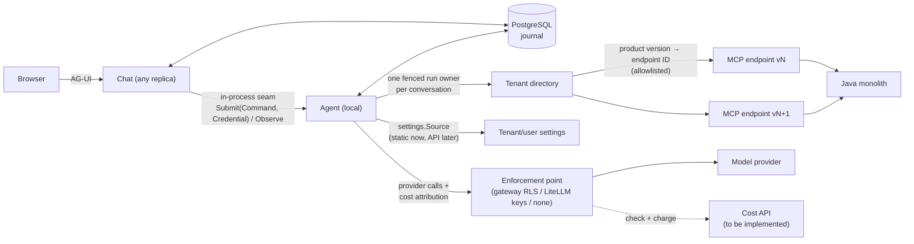
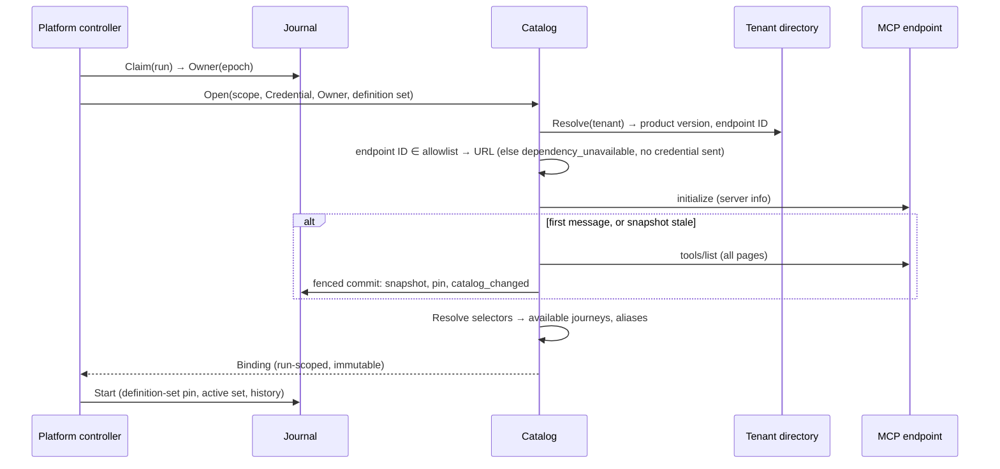
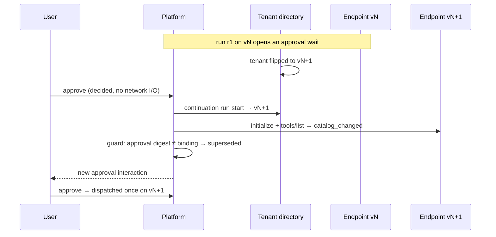
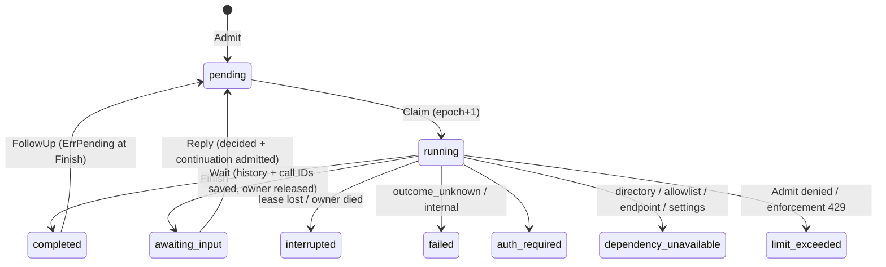
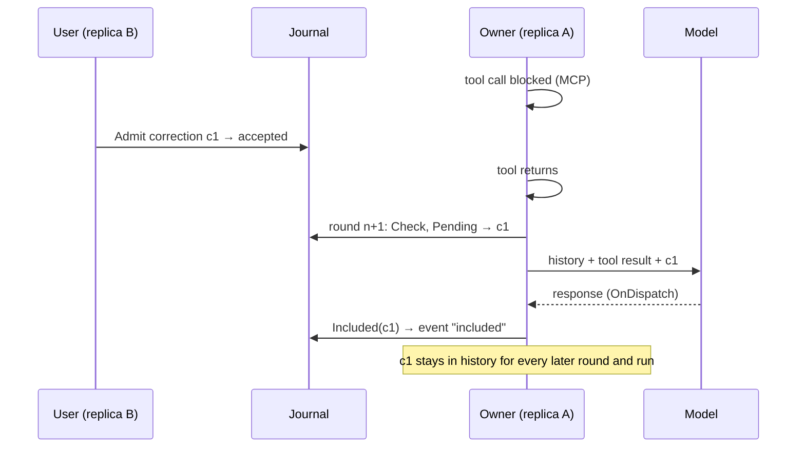
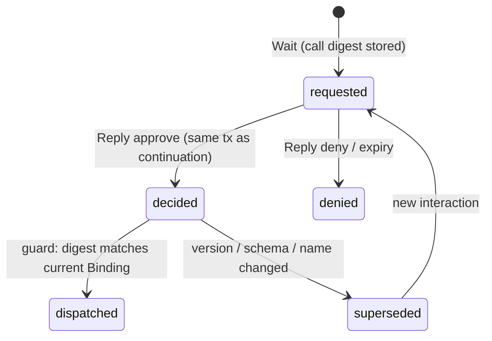
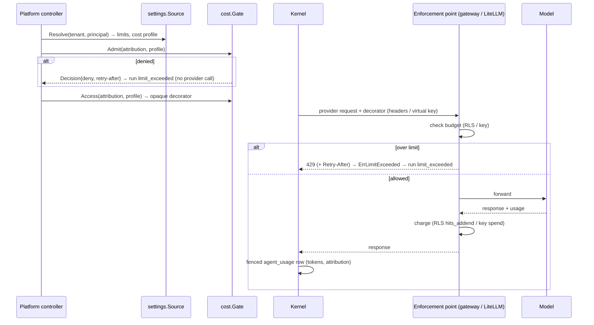
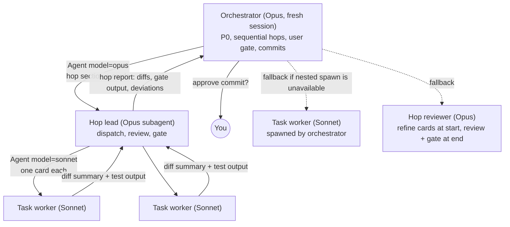

# Agent Platform: migrate TARGET to the conversation-agent design

## Context

`az-agent-platform-go` (TARGET, `main` at `555fba3`) already implements Tasks 1–6 of the old hub-and-spoke plan:

- a keyword router;
- one MAF session per journey;
- exact-name MCP allowlists;
- a static MCP endpoint.

`docs/acceptance.md` says V1 is incomplete: the fixture checks PASS and the real-boundary checks are BLOCKED.

The design was revised on 2026-10-17/18. The source of truth is the MAF repo's untracked spec at `docs/superpowers/specs/2026-09-14-hub-and-spoke-agent-platform-design.md`, together with `2026-10-17-harness-and-paradigm-review.md`, the revised `interfaces.md` and the revised `CONTEXT.md`. Under the revised design:

- one conversation agent serves each thread;
- journeys are `SKILL.md` bundles activated by a tool;
- tools are selected by `_meta` operation key;
- each conversation pins a catalog snapshot;
- each tenant reaches the MCP endpoint for its product version.

You also asked for two **seams** (2026-10-18), meaning extension points that are built and tested now, while the mechanism behind them is chosen later:

- **Tenant and user settings** that an API can later supply. `max_active_journeys` is the first such setting.
- **A cost API** whose enforcement sits outside the platform: an Envoy RLS service, a Linkerd-based RLS service, or LiteLLM virtual keys per tenant and per user, possibly in front of a gateway such as agentgateway.

This plan migrates the existing code to that design in **hops**. Each hop is gated by one growing E2E acceptance check. Nothing is rebuilt greenfield.

**Correction to the earlier draft:** TARGET owns its tool loop. `internal/runtime/interactions.go` `runHarness` runs up to 16 rounds. A bare `agent.New(ProviderConfig{Run: modelRun…})` is built **once** per run (`interactions.go:106`), with a fixed tool list. Each round calls `inner.Run` for one provider call, and the product dispatches the tools itself. Rebuilding it per round (in H4b) is a real change. The Foundry adapter sets `MaximumIterationsPerRequest=0`. Consequences:

- **No MAF fork is needed.** Drop the fork hook (`Config.ProviderMiddlewares`) and the exported `mcptool.NewTool`.
- **MessageInjector concerns do not apply.** Steering already works: `Store.Pending` drains the inbox each round, and `OnDispatch` calls `Store.Included`.
- **Run segments simplify.** The next round rebuilds the inner agent with the new active set's tools and instructions, and the dispatcher rejects any tool that is not active. The fail-closed property is the same.

### Verified against the code (2026-10-18)

| Claim | Evidence |
|---|---|
| `CallTool` is sent the **normalized** name. It breaks for any remote name with characters outside `[A-Za-z0-9_.-]` (for example `/`, a space or `:`). Dots survive normalization. | `internal/mcp/client.go:69-80,102` matches `allowed` against `listed.Name()`, which MAF normalizes (`mcptool/mcp.go:443,453-460`), then sends that name. |
| The policy classes and the approval rule live in the journal. | `journal/operations.go:18` accepts only `read_only`, `effectful` and `deduplicated`, and `:34-45` requires a consumed approval for any first attempt that is not read-only. `runtime/tool_policy.go:42` retries on `deduplicated`. |
| Listing is single-page. | MAF `mcptool.ListTools` calls `session.ListTools(ctx, nil)` and never follows `NextCursor` (`mcptool/mcp.go:50-51`). |
| `agent_sessions(thread_id, journey_id)` is FK-referenced by `agent_runs` and `agent_interactions`. | `migrations/000001…:18-30`, `000004…:7-14` |
| Providers ignore `SkillCatalog` and `SkillMaterial`. | Only `request.Instructions` is read (`provider/litellm/litellm.go:81`, `provider/foundry/foundry.go:110`). |
| Definitions are pinned **per journey**. | `agent_definition_current(journey_id)`; `journal/sessions.go:30-45` |
| Tenant is folded into the principal, and `Command` has no tenant. | `chat/keycloak_auth.go:388` `canonicalPrincipal`; `platform/platform.go:39` |
| Raw request headers cross the seam. | `chat/http.go:137` passes `Headers: r.Header`, filtered later by `server.ForwardHeaders` (`mcp/client.go:40-45`). |
| An unresolved effect blocks the whole thread. | `journal/sessions.go:22-27` (`ErrOutcomeUnknown` at `Start`) |

## Decisions

Settled 2026-10-17/18 (design):

- **No hub or router.** One conversation agent and one session per conversation.
- **Journeys** are `SKILL.md` bundles, activated by the non-invocable `activate_journey` tool.
- **Active set:** at most **N** active journeys, evicted least-recently-used. **N is set per tenant** (`max_active_journeys`, default 2; changed 2026-10-18). A journey with a pending approval or an unresolved `outcome_unknown` is pinned. If all N active journeys are pinned, a further activation is refused, and the refusal is returned as the tool result.
- **Instructions** come from the active set on every request. They are never stored in transcript history.
- **Tools** are selected by `_meta` operation key, never by name.
  - Java owns the keys, tags and annotations.
  - The platform owns the selectors and an overlay that can only narrow.
  - The model sees stable aliases.
- **Catalog snapshots** are raw paginated `tools/list` descriptors captured at the first message. They are immutable, addressed by digest, stored per principal, and each conversation pins one. They are revalidated at run start and are never authorization.
- **Product versions:** a tenant directory maps tenant → product version → endpoint, and the endpoint is allowlisted before any credential is sent. There is a support window, and CI fixtures exist per version. On a version change, decided approvals are superseded and clarifications survive.
- **Approval markers:** decided (at reply, no network I/O), dispatched (at the guard), superseded (when the catalog or version changed).
- **`Credential`** is an opaque type that redacts itself.
- **Error encoding:** business, entitlement and validation rejections become model-visible results. Only `outcome_unknown`, `auth_required` and internal failures are errors.

Settled 2026-10-18 (migration, this session):

- **Sessions:** archive the per-journey sessions and keep the latest one. The thread history is taken from the most recently used journey session, and the old rows move to `agent_sessions_archived`.
- **Config:** real YAML, strictly decoded (`yaml.v3` with `KnownFields(true)`).
- **Execution:**
  - **Roles.** An **Opus orchestrator session** with a fresh context runs the hops sequentially on one branch (`migrate/conversation-agent`). For each hop it spawns an **Opus hop-lead subagent**, and the lead delegates **Sonnet-sized task cards** to **Sonnet subagents**. A probe at the start checks that nested spawning works, and there is a defined fallback if it doesn't. See [Execution model](#execution-model).
  - **Commits.** One commit per hop, made only after you approve it. One PR at the end.
  - **Overrides.** This replaces the handoff's "don't override subagent models" and `AGENTS.md`'s superpowers rules. It keeps `AGENTS.md`'s orchestrator-only and model-routing intent.

Decisions taken here (derived from the spec):

- **Settings seam.** A `settings.Source` port with `Resolve(ctx, Scope{Tenant, Principal}) (Settings, error)`.
  - **Adapters.** It has a static-file adapter now. The HTTP/API adapter, and an admin API that writes settings, are left room for and deferred.
  - **Layering.** Values layer deploy default → tenant → user. A user value may only **narrow** the tenant's limits.
  - **Typing.** `Settings` is a typed struct with a version digest. Unknown fields are rejected, so each new setting is a code change.
  - **When it applies.** Settings are resolved once at run start and recorded on the run (digest plus applied values). A resolution failure is `dependency_unavailable`, before any dispatch.
  - **V1 fields:**
    - `max_active_journeys`: default 2, allowed 1–4. The cap bounds tools per request to N × `max_tools`.
    - `cost.profile`: an opaque reference that the cost adapter interprets.
  - **Limit changes.** If a limit drops mid-conversation, the next run start evicts unpinned journeys (LRU first) down to the new limit. Pinned journeys are never evicted, and activations are refused until the set is below the limit.
- **Cost seam.** The platform owns attribution, typed outcomes and a usage record. The enforcing component, chosen later, owns budgets and counting. Details are in [Settings and cost seams](#settings-and-cost-seams).
- **Retry and approval classes.** The overlay's classes are `read_only`, `idempotent` and `effectful`; TARGET's `deduplicated` is renamed `idempotent`. Approval is required unless the class is `read_only`, and `approval: required` can add it even to a read-only operation, since the overlay only narrows. MCP annotations never grant `read_only`; the class comes only from the reviewed overlay. The run computes `requires_approval` and the journal enforces it.
- **No cross-journey context.** With one history per thread, the inbox's "context from the latest completed run outside this journey" (`journal/inbox.go:71`) is removed in H4a.
- **Intermediate hops are not deployable.** Only the final branch state is deployed. Migrations must still upgrade a populated database correctly, and the migration tests prove it.
- **Supporting files.** `load_skill` is removed: activation plus active-set instructions replace it. `read_skill_resource` stays, scoped to active journeys, because the spec keeps on-demand supporting files.
- **Definition pin.** A conversation pins one definition **set** digest. `agent_definition_current` becomes a single row.
- **`outcome_unknown` stays strict.** TARGET's thread-level stop at `Start` is kept for V1. The journey pin is recorded as well, so a later reconcile path can relax the stop to the journey.
- **Packages.** Keep TARGET's packages where they already play a spec module. Rename `internal/mcp` to `internal/catalog`. Add `internal/credential`, `internal/tenantdir` and `internal/journeys`.

## Target architecture



### Spec module → TARGET package

| Spec module | TARGET today | After migration |
|---|---|---|
| Platform controller | `internal/platform` (`Submit(ctx, Submission{Command, Headers})`) | same package; `Submit(ctx, Command, credential.Credential)`; `Command.Tenant` |
| Journal | `internal/journal` | adds conversation state (history, active set, pins), catalog snapshots, approval markers |
| Definitions | `internal/definitions` `Registry` (JSON, exact names, routing) | `definitions.Set` (YAML, selectors, overlay, version ranges); no routing |
| Catalog → Binding | `internal/mcp` `Client.Bind` / `Bound.Call` | `internal/catalog`: `Open → *Binding`, pure `Resolve`, aliases, guard, classification |
| Journeys | `internal/skills` plus per-journey runtime | `internal/journeys`: active set, LRU, pinning, instruction composition; `internal/skills` keeps bundle reading |
| Transcript | `journal` inbox (`Pending`/`Included`) plus `runHarness.invoke` | unchanged; a regression guard is added |
| Kernel | `internal/runtime` `runHarness` | same; rebuilds the inner agent each round from the active set |
| Settings | — | `internal/settings`: `Source` port (static file, mutable test, API later) |
| Cost | — | `internal/cost`: `Gate` port (`Open` no-op, `Headers`, scripted test; RLS and LiteLLM keys later), `Attribution`, usage record |
| Ports | — | `tenantdir.Directory`, `settings.Source`, `cost.Gate`, `chat` auth, `runtime.Model` |

Interfaces stay limited to the ports. Everything else is a concrete type, so no Compiler, Router, SelectorResolver or SnapshotStore interfaces are added.

## Behaviour (target, expressed in TARGET's loop)

H6b amends aliases, recency, the context budget, definition re-pin, tag-selector classes, settings narrowing and 403 handling. Where this section is silent or older, `docs/design.md` wins.

### Conversation agent and journeys

- **What the model sees.** The model gets metadata (name and description) for the journeys **available to this user**. A journey is available when every required operation resolves in the user's snapshot.
- **What a journey is.** A journey is a `SKILL.md` bundle, a selector, an overlay and a product-version range. The per-journey `system_prompt` file is folded into the `SKILL.md` body. A platform-level `configs/conversation.md` supplies the base prompt.
- **Activation.** `activate_journey{journey}` is dispatched by the runtime, as `load_skill` is today. It validates availability and makes a fenced write of the active set, then answers with a short ack. Any other calls in the same response are answered with "not executed; call again after activation", so the history stays well-formed. An explicit `TargetJourney` activates its journey before round 0.
- **Next round.** The next round rebuilds `inner` with the active journeys' alias tools plus `request_user_input`, `activate_journey` and `read_skill_resource` (the last only when the active journeys have supporting files). Its instructions are the base prompt, the available-journey metadata, and the active journeys' `SKILL.md` bodies.
- **Calls to inactive tools.** A call to a tool that is not active returns `{"error":"tool_not_active"}` as a nil-error result. It is never dispatched. Today `tool is not allowed` fails the run instead.
- **Instructions and history.** Journey instructions are never written into history, so compaction cannot lose them.

```mermaid
sequenceDiagram
    participant K as Kernel (runHarness)
    participant JN as Journeys (active set)
    participant AG as inner agent (one provider call)
    participant M as Model
    participant B as Binding
    K->>JN: compose(available metadata, active set)
    K->>AG: round n: tools = active aliases + built-ins
    AG->>M: request
    M-->>AG: activate_journey("vacation-planning") [+ sibling calls]
    AG-->>K: calls
    K->>JN: activate (settings limit N, LRU, pinning) → fenced journal write
    K->>K: ack result; siblings = "not executed"
    K->>AG: round n+1: rebuilt with new active set's tools + instructions
    AG->>M: request
    M-->>AG: call leave_balance (alias)
    K->>B: Call(alias) → remote name (lease → guard → retry → classify)
    B-->>K: result
    K->>AG: round n+2
    AG->>M: request
    M-->>AG: final answer
```

### Tool catalog

- **Operation keys.** `_meta` carries a namespaced, stable operation key per tool, plus optional tags. MCP `annotations` carry side-effect hints. The `_meta` key name is set in config (`catalog.operation_meta_key`) because it is an integration input. `_meta` describes what a tool *is*, never which journey uses it.
- **Selectors and overlay.** Selectors name operation keys (with alternatives in preference order), or tags narrowed by hints. The overlay can only narrow: deny an operation, require approval, or set the retry class (`read_only`/`idempotent`). It is authoritative for approval and retry.
- **Resolution** happens at run start against the snapshot. A missing or ambiguous required operation, or a set over `max_tools`, makes the journey **unavailable**. It is hidden, never failed mid-turn. Name normalization and collision checks run per journey, after filtering.
- **Aliases.** One alias per op selector (from H6b; before H6b, derived from the resolved key): a selector with more than one alternative must declare `alias:`, a single-alternative selector defaults to its key (`leave_balance`), and a tag-only match derives from its own key. Binding maps each alias to the user's remote name at call time, which fixes the `CallTool` name bug. Description and schema come from the server.
- **Snapshots:**
  - **Contents:** raw descriptors including `_meta` and annotations.
  - **Scope:** stored per `(tenant, principal, product version, endpoint ID)`, with a per-principal "latest" pointer. Each conversation pins one digest, and one conversation's revalidation never moves another conversation's pin.
  - **Capture:** on the first message, by paging `tools/list` to completion with the go-sdk's `ClientSession.Tools` iterator. MAF's `ListTools` is not used.
  - **Revalidation:** at run start. It re-lists only when the product version, server version (`initialize`) or endpoint changed, or the TTL expired.
  - **Authorization:** never. Java authorizes every call.



- **Binding** is run-scoped and immutable, and owns the run's credentialed MCP session. `Call` runs, in order:
  1. lease check;
  2. approval guard;
  3. retry (overlay `read_only`/`idempotent` only), which reuses `guardedCall`;
  4. classification.

  Business rejections, entitlement rejections, validation failures and `isError` are nil-error results. Only `outcome_unknown`, `auth_required` and internal failures are Go errors.

### Product versions

- **Directory and pinning.** `tenantdir.Directory.Resolve(tenant)` returns `{ProductVersion, EndpointID}`. Per-tenant behaviour settings live in `settings.Source`, not in the directory. The URL comes **only** from the deploy-time allowlist, keyed by endpoint ID, so the transport accepts only resolver-built endpoints. A run records `(definition digest, product version, endpoint ID, catalog digest)`.
- **Connections.** In-flight runs keep their endpoint and session until they finish. One HTTP transport pool serves each endpoint, and the credential is applied per request.
- **Compatibility.** Each journey declares `product_versions` and relies on its required keys. The support window is the current version plus the two before it (proposed). A Go test resolves every journey against `testdata/catalogs/<version>/tools.json`.
- **On upgrade or rollback:**
  - the next run re-lists, re-resolves and records `catalog_changed`;
  - history stays coherent through the aliases;
  - decided approvals become superseded, and clarifications survive;
  - `outcome_unknown` stays unresolved;
  - versions are not assumed to increase.



### Durability, ownership, steering (kept; regression-guarded)

These are kept, and the E2E guards them against regressions:

- **Ownership.** Claim increments the epoch. Every owned write, and every dispatch to the provider or MCP, checks the epoch and lease against the database clock. Lease loss makes the run `interrupted`, with no takeover.
- **Admission and finish** lock the same conversation (`Finish` returns `ErrPending`, which leads to a live-owner follow-up).
- **Steering.** Corrections are drained from the inbox at each round. The provider's `OnDispatch` calls `Store.Included`. A correction stays in history for every later request.





### Human waits and approvals

- **Clarification.** One to three questions, each with two or three described options, plus optional custom text. It supplies information only. This is unchanged.
- **Approval binding** is an immutable digest over:
  - the operation key;
  - the resolved-name digest;
  - the input-schema digest;
  - the canonical arguments (`json.Number`, with trailing data rejected);
  - the product version, principal, conversation and definition-set digest.



Denial, timeout, custom text and changed arguments never authorize anything.

### Effects, retry, telemetry

- **Effects and retry.** `outcome_unknown` gets no retry and no model re-issue; the run ends and the journey is pinned. Model SDK retry stays disabled. The run has one retry budget, one logical operation ID and distinct attempt IDs. A directory or endpoint failure before dispatch is `dependency_unavailable`.
- **Trace shape.** Spans are `chat.accept`, `agent.start_turn`, `catalog.resolve`, `model.call` and `mcp.call`. `hub.route` is removed; `journey.run` is kept (user decision). Activation is a span event.
- **Attributes.** Opaque IDs, journey IDs, operation key, alias, product version, endpoint ID, catalog digest, active-journey limit, outcome, latency and retries. **No** dynamic tool names, descriptions, content or credentials. A span processor drops `gen_ai.tool.description`.

### Settings and cost seams

The seams decouple **what the platform knows** (who is calling, for which conversation, and what it used) from **who enforces** (a gateway RLS, LiteLLM keys, or nothing).

- **Attribution.** `cost.Attribution{Tenant, Principal, Conversation, Run, Journey}` holds opaque IDs only, never credentials or content. The controller builds it at run start.
- **`cost.Gate`** is a port:
  ```go
  type Gate interface {
      // Admit runs at run start, before the first provider call.
      Admit(ctx context.Context, a Attribution, s settings.Cost) (Decision, error)
      // Access returns a redacting, opaque decorator applied by the model provider's HTTP transport.
      Access(ctx context.Context, a Attribution, s settings.Cost) (Access, error)
  }
  ```
- **Adapters built now:**
  - `Open` (default): admits everything and decorates nothing.
  - `Headers`: configurable header names carrying attribution. Envoy RLS, Linkerd RLS and agentgateway `remoteRateLimit` descriptors can key on them, for example `request.headers["x-agent-tenant"]`.
  - `Scripted`: for tests.
- **Adapters with room left:**
  - `LiteLLMKeys`: `Access` sets the per-tenant or per-user virtual key, and `Admit` reads the key's budget.
  - A direct RLS pre-check.
- **Typed limit outcomes.** Providers classify enforcement rejections:
  - an HTTP 429 with a budget signal (agentgateway `"code":"budget_exceeded"`, or LiteLLM's budget error) becomes `ErrLimitExceeded{Kind: budget, RetryAfter}`;
  - any other 429 becomes `{Kind: rate}`.

  The run ends in a new state, `limit_exceeded`, with an event carrying the reason and `Retry-After`. It is never retried in-run and is never `outcome_unknown`. Chat maps it to an AG-UI error. An `Admit` denial produces the same state before any provider call.
- **MCP behind a gateway.** A rate-limit `isError` result from `tools/call` is a business rejection the model sees. A JSON-RPC limit error on `initialize` or `tools/list` becomes `limit_exceeded` at `Catalog.Open`.
- **Usage record.** Providers return `ModelResponse.Usage{Model, Input, Output, Cached}` tokens. These are written as fenced `agent_usage` rows per model call, carrying the attribution. `cost.Usage(scope, window)` is the read side the future cost API builds on. The platform computes no USD; pricing belongs to the enforcer (agentgateway's model catalog, or LiteLLM's).
- **Trust.** Attribution headers count only if the enforcement point accepts them solely from Agent, through mTLS or network policy, or later a signed service token. Model calls originate inside Agent, so client headers never reach them.



### Journey definition format

The format is real YAML, strictly decoded:

```yaml
catalog:
  operation_meta_key: com.example/operation   # integration input
journeys:
  - id: vacation-planning
    skill: skills/vacation-planning/            # SKILL.md: metadata + instructions (+ supporting files)
    product_versions: {min: "2026.2", max_exclusive: "2027.1"}
    tools:
      - op: leave.balance
        class: read_only                        # class is allowed only on op selectors (H6b)
      - op: [leave.request.v2, leave.request]   # alternatives in preference order
        alias: leave_request                    # required (H6b): more than one alternative
        approval: required                      # overlay may only narrow
      - tags: [leave]                           # no class: tag-only matches are effectful
        read_only: true                         # hint filter, not a class
    max_tools: 15
```

- **Startup validates** duplicate IDs, paths (no escaping or symlinks; reuse `definitions/registry.go:27 compileSkill` and `skills/source.go secureRead`), selectors, overlays and version ranges. It never validates tool names.
- **Rollout.** The compiled set is digest-addressed. `AGENT_PLATFORM_RETAINED_CONFIGS` keeps needed sets loadable, and readiness (`Store.DefinitionsReady`) requires the current set plus, from H6b, only sets referenced by open waits or unresolved operations; idle conversations re-pin at run start.

## Migration

### E2E acceptance check and progress ratchet

The check is a single black-box test, `TestE2EConversationAgent`, in `integration/e2e_test.go`. It uses:

- real Chat HTTP (`chat.NewHandler`);
- **three** in-process replicas, using the existing `startAcceptanceReplica` (`integration/acceptance_test.go:34`) moved into `integration/harness_test.go`;
- PostgreSQL 16, through the existing `database(t)` helper;
- two `mcptest` endpoints (vN and vN+1);
- two tenants whose remote tool names differ;
- the scripted model.

It runs as ordered subtests:

| Stage | Asserts | Hop |
|---|---|---|
| S0 | AG-UI POST on A → MCP call → answer, with current code | H0 |
| S1 | A sentinel credential never appears in any DB text/jsonb column, the events, the captured `slog` output or the spans, while MCP still receives it | H1 |
| S2 | Tenant A → vN and tenant B → vN+1. A directory entry for a non-allowlisted endpoint → `dependency_unavailable`, and the endpoint receives **zero** requests | H2 |
| S3 | A paginated snapshot (page size 2) is captured at the first message. Both tenants' requests show the same aliases, and MCP receives each tenant's own remote names, including ones with `/` and a space, which normalization would rewrite. A second run revalidates without `tools/list` | H3 |
| S4 | After `activate_journey`, only that journey's aliases are in the next request. A sibling call is not executed. For tenant A (settings limit 2), a second journey becomes active and a third evicts the LRU one. For tenant B (limit 1), the second activation evicts the first. A user-level setting can narrow A's limit to 1. Lowering a limit evicts down at the next run start. A pinned journey is never evicted. After restarting all replicas, the active set and history persist | H4b |
| S5 | A correction admitted through replica B while A's tool is blocked appears in every later provider request, and a reconnect on C is gap-free | H4b |
| S6 | Approval wait → tenant moved to vN+1 → approve → superseded plus a new interaction → approve → dispatched exactly once on vN+1. A clarification reply survives the same flip | H5 |
| S7 | Runs the **real `litellm` provider** over HTTP against `modeltest.ResponsesServer`, a scripted OpenAI-Responses-compatible stub acting as the enforcement point. It receives `Headers` attribution on every model request (no credential in it). Its 429 `budget_exceeded` → run `limit_exceeded` with `Retry-After`, no retry, no `outcome_unknown`. A `Scripted` `Admit` denial → `limit_exceeded` with zero model requests. `agent_usage` rows match the stub's reported tokens | H6 |
| S8 | Design corrections (see H6b): one alias for a `[k.v2, k]` selector across two tenants on different alternatives and across a version flip, each tenant's own remote name at MCP; history truncation with a `history_truncated` event; idle definition re-pin with `definition_changed`; dispatch keeps a journey from eviction; 403 → `not_permitted` result, run continues | H6b |
| S9 | An apply-then-drop-response effect → `outcome_unknown`, no retry, the journey pinned. The trace has no content, tool descriptions or remote names | H7 |
| S10 | Definition rollout only through `agent-platform activate`: D1 then D2 are activated by the entry point (never `Store.ActivateDefinition` directly); a second `activate` of D2 succeeds; every replica stays Ready with no local definition files; a conversation waiting on an approval under D1 completes on D1; an idle one re-pins to D2 with `definition_changed`; a new one runs on D2 | F1 |

The ratchet is `integration/e2e_progress_test.go`, which declares `const e2eReachedStage = N`:

- stages ≤ N must pass;
- stages > N call `t.Skip("pending: Hk")`;
- each hop writes its stage body **test-first** (red), implements, and bumps N in the same commit.

**A hop is done when** S0…S*k* pass and `go test -race ./... -count=1` is green, including the rewritten older tests.

```mermaid
flowchart LR
    H0["H0 Baseline + E2E harness<br/>S0"] --> H1["H1 Credential seam<br/>S1"]
    H1 --> H2["H2 Tenant directory, allowlist,<br/>settings seam · S2"]
    H2 --> H3["H3 Catalog: snapshots,<br/>selectors, aliases · S3"]
    H3 --> H4a["H4a One session per thread<br/>(router kept) · S0–S3 still green"]
    H4a --> H4b["H4b activate_journey,<br/>active set · S4 S5"]
    H4b --> H5["H5 Approval markers,<br/>supersede · S6"]
    H5 --> H6["H6 Cost seam: attribution,<br/>Gate, limit outcome, usage · S7"]
    H6 --> H6b["H6b Design corrections:<br/>aliases, budget, re-pin, LRU · S8"]
    H6b --> H7["H7 outcome_unknown pin, telemetry,<br/>deploy, docs, CI · S9"]
```



Each hop adds at most one forward-only SQL migration. **Numbers are positional:** a migration's version is its index in `migrationNames` (`journal/migrate.go:17`), so a new file takes the next free number when it lands, and a duplicate or skipped number is a silent error. Landed: `000007` H2, `000008` H3, `000009` H4a, `000010` H4b, `000011` H5, `000012` H6 (`000012_usage_limit.sql`); H6b added none. Planned: `000013` F1 (definition store), then `000014` for F3 only if a card needs one.

### P0: Prerequisites (orchestrator, before H0)

- **Toolchain and modules.** `go.mod` needs Go 1.26.0, but the local Homebrew Go is 1.25.0. The toolchain download and the module cache writes fail inside the sandbox, so run `go version` and `go mod download` once with the sandbox lifted, after asking you.
- **Docker.** Confirm that Docker can start `postgres:16`, or that `TEST_DATABASE_URL` is set.
- **Baseline.** Record a green baseline, `go build ./... && go test -race ./... -count=1`, on the branch before H0.

### H0: Baseline and E2E harness

- **go-sdk contract first.** Before any fixture relies on them, a contract test pins the go-sdk APIs the plan uses:
  - `ServerOptions` paging;
  - `ClientSession.Tools`;
  - `InitializeResult()`;
  - `Tool.Meta`.
- **`internal/mcptest`.** A go-sdk streamable-HTTP server in `httptest`, consolidating the inline servers in `journey_test.go:63`, `outcomes_test.go:518` and `acceptance_test.go:141`. It provides:
  - catalogs per `(tenant, principal, version)`, with `_meta` operation keys, tags, annotations and a page size;
  - header capture;
  - per-tool controls: block, transient failure, apply-then-drop-response, `isError`, 401;
  - request counters per method.
- **`internal/modeltest`.** A scripted `runtime.Model` that records every `ModelRequest`. The existing `modelFunc` stays for the old tests.
- **`internal/pgtest`.** The PostgreSQL 16 container and fresh-database helper, moved out of `integration/postgres_test.go`, so journal packages can test migrations package-locally.
- **E2E files.** `integration/harness_test.go` (the replica helpers are moved, not copied), `integration/e2e_test.go` with S0 green and S1–S8 skipped, and `e2e_progress_test.go` with N=0.
- **Docs:**
  - copy the revised spec, plus this plan's design deltas, to `docs/design.md`;
  - replace `CONTEXT.md` with the revised glossary;
  - add superseded headers to `docs/superpowers/**`.

  `docs/migration.md` is already written at approval.

### H1: Credential seam

- **The type.** Add `internal/credential` as a leaf package, so the catalog can import it without a cycle. `Credential` has unexported headers, and `String`, `GoString`, `Format`, `MarshalJSON` and `LogValue` all redact. `FromRequest(r, names)` copies only the configured header names. `Apply(*http.Request)` is the only way to use a credential.
- **Wiring:**
  - `platform.Submit(ctx, Command, Credential)` replaces `Submission{Headers}`;
  - `RunInput.Headers` becomes `Credential`;
  - the MCP `headerTransport` applies the credential;
  - `forward_headers` moves from the per-server config to `AGENT_PLATFORM_CREDENTIAL_HEADERS`.

### H2: Tenant directory, allowlist, settings

- **`internal/tenantdir`.** The `Directory` port with a `Static` adapter (YAML, from `AGENT_PLATFORM_TENANT_DIRECTORY`) and a `Mutable` one. The HTTP adapter waits for the directory API.
- **Allowlist.** `AGENT_PLATFORM_MCP_ENDPOINTS` maps endpoint ID → URL. The resolver returns an ID, and only the allowlist yields a URL.
- **`internal/settings`.** The `Source` port with a `Static` adapter (strict YAML, from `AGENT_PLATFORM_SETTINGS`, layered default → tenant → user, where the user layer only narrows, with bounds checked) and a `Mutable` one.
  - `Settings{MaxActiveJourneys, Cost{Profile}, Digest}`.
  - Settings are resolved after the directory. H2 records them, and H4b and H6 consume them.
  - An API adapter and an admin write API are left room for.
- **Tenant at the seam.** Chat's identity exposes the tenant, and `Command.Tenant` is added to the durable command.
- **Server info.** Record `initialize` server info.
- **Migration `000007`:**
  - `agent_runs.{product_version, endpoint_id, settings jsonb}`;
  - the new terminal state `dependency_unavailable`.

  A new state always touches four places: the allowed states in `Finish` (`journal/sessions.go:68`), the `agent_commands.terminal_reason` CHECK (`000006`), the event CASE in `journal/observe.go`, and the Chat mapping (`chat/http.go:222`).
- **Config.** `mcp_servers[].endpoint` and the `${TEST_JAVA_MCP_ENDPOINT}` substitution are removed. Tests use `tenantdir.Mutable`.

### H3: Catalog

- **New package.** `internal/catalog` replaces `internal/mcp`. `internal/mcp` is deleted in the wiring card; there is no `git mv`.
- **`Open`.** `Open(ctx, scope, cred, owner, set) (*Binding, error)` does directory → allowlist → `initialize` → revalidate → paginated listing → fenced snapshot commit.
- **`Resolve`.** A pure function `Resolve(journey, snapshot, metaKey) Resolution` resolves selectors, overlay, aliases, collisions, `max_tools` and the reasons a journey is unavailable.
- **Tools.** Descriptor-backed alias `SchemaTool`s; `Binding.Tools(ids…)`; `Binding.Call(alias)` sends the **remote** name.
- **Migration `000008`:**
  - snapshots (`digest PK`, tenant, principal, `product_version`, `endpoint_id`, `server_version`, `descriptors jsonb`, `captured_at`);
  - latest pointers;
  - conversation `catalog_digest` and `product_version`;
  - run `catalog_digest`;
  - `agent_operations.{operation_key, alias, requires_approval}`, with the remote name no longer stored;
  - the policy rename `deduplicated → idempotent` (rows updated, the CHECK widened);
  - the `catalog_changed` event.

  `BeginAttempt` enforces approval through `requires_approval` and retries through `read_only|idempotent`.
- **Definitions** are compiled from YAML (`go.yaml.in/yaml/v3`, `KnownFields`) into a digest-addressed `Set` with these keys:
  - `catalog.{operation_meta_key, call_id_header}`;
  - per journey `skill`, `product_versions`, selectors, overlay and `max_tools`;
  - `routing`, still accepted until H4b.

  The old JSON `Load`/`Registry` stays until the wiring card replaces it.
- **Fixtures.** `testdata/catalogs/{v1,v2}/tools.json`, plus a test that resolves every journey against each supported version.

### H4a: One session per thread (router kept)

This hop changes **storage only**. Behaviour stays the same, so S0–S3 stay green, and N stays at 3.

- **Migration `000009`.** Its exact contract:
  ```sql
  ALTER TABLE agent_conversations ADD COLUMN history jsonb NOT NULL DEFAULT '[]',
      ADD COLUMN definition_digest text, ADD COLUMN active_journeys jsonb NOT NULL DEFAULT '[]';
  -- latest *executing* run with a journey, per thread; reply/steering rows are not executing runs
  UPDATE agent_conversations c SET history = s.history
  FROM (SELECT DISTINCT ON (r.thread_id) r.thread_id, r.journey_id
        FROM agent_runs r JOIN agent_commands k ON k.execution_run_id = r.id
        WHERE r.journey_id IS NOT NULL
        ORDER BY r.thread_id, k.ordinal DESC) latest
  JOIN agent_sessions s ON (s.thread_id, s.journey_id) = (latest.thread_id, latest.journey_id)
  WHERE c.id = latest.thread_id;
  -- then: drop FKs agent_runs/agent_interactions → agent_sessions; rename agent_sessions → agent_sessions_archived;
  -- rename agent_definition_current → agent_definition_current_archived and create
  -- agent_definition_current(singleton boolean PRIMARY KEY DEFAULT true CHECK (singleton), definition_digest text NOT NULL CHECK (length(definition_digest)=64));
  -- agent_operations ADD journey_id text; conversations keep definition_digest NULL (re-pinned to current at next run)
  ```
  Old per-journey digests are therefore never required for readiness. An approval still pending from before the migration is superseded once H5 lands, because its digest no longer matches: it fails closed and is asked again. A pending clarification resumes.
- **Journal on the conversation row:**
  - `Start`, `Finish`, `Wait` and `Continuation`;
  - `ResolveDefinition`, `ActivateDefinition`, `CurrentDefinition` and `DefinitionsReady`, all by set digest.

  Remove the inbox's cross-journey `Context` selection (`inbox.go:71`) and `ModelRequest.Context`.
- **Call sites.** `runtime`, `platform`, and the integration tests that touch sessions or definitions:
  - persistence, replay, ownership, telemetry and steering;
  - skills, interactions and definitions, including `definitions_test.go:257`, `TestVersionAwaitingSessionUsesRetainedProviderBundle` and the context assertions of `TestJourneyDefinitionRoutesAndMaterializesContext`.

### H4b: Single conversation agent

- **Remove routing:** `runtime/router.go`, `Infer`, `Routing`, `hub.route`, the routing half of `Runner.Binding`, and `load_skill`.
- **`internal/journeys`.** Pure, unit-tested logic:
  - `ActiveSet.Activate(id, limit, pinned)` and `Fit(limit, pinned)`, with LRU;
  - `Compose(base, available, active)`.

  The limit always comes from `Settings`.
- **`runHarness` changes:**
  - build `inner` per round;
  - dispatch `activate_journey`, answering sibling calls with "not executed";
  - return `tool_not_active` as a result;
  - scope `read_skill_resource` to active journeys;
  - persist the active set in `Wait` and `Finish`;
  - activate an explicit target before round 0.
- **Migration `000010`** (`000010_active_set.sql`, landed in `3244bad`): an array CHECK on `agent_conversations.active_journeys`; a run may carry a definition pin without a journey; `agent_interactions.journey_id` becomes nullable for clarifications. `Store.ActiveJourneys`/`SetActiveJourneys` (fenced) read and write the set.
- **Providers.** Drop `ModelRequest.SkillCatalog` and `SkillMaterial`. `Provenance` covers the active set.
- **Config.** Fold `configs/prompts/*.md` into the `SKILL.md` bodies, and add `configs/conversation.md`.
- **Tests to rewrite** as activation equivalents:
  - `TestDeclarativeJourneyRouting`;
  - `TestVersionActivationPreservesPinnedSessions`;
  - `TestCrossJourneyActivationCannotMutateCurrentOrPin`;
  - `TestSkillRuntimeLoadsOnlySelectedMaterial`;
  - `TestSkillCatalogAndControlledReads`.

### H5: Approvals

- **Migration `000011`** (`000011_approval_markers.sql`, landed). `agent_interactions` gains:
  - `marker` (requested, decided, denied, dispatched, superseded);
  - `operation_key`, `name_digest`, `schema_digest`, `product_version`, `catalog_digest` (`definition_digest` exists since `000004`);
  - `active_journeys`.
- **Binding v2.** It covers the operation key, name digest, schema digest, canonical arguments (`json.Number`, with trailing data rejected), product version, principal, conversation and definition-set digest. It is used by `Wait`, `Reply` and `BeginAttempt` (`operations.go:17`) and by `runHarness` (`interactions.go:238`).
- **Markers.**
  - `Reply` sets `decided` in its transaction.
  - The guard compares the digest against the continuation's Binding. A mismatch marks the approval `superseded` and opens a new `Wait`. A match sets `dispatched` in the `BeginAttempt` transaction.

### H6: Cost seam

- **`internal/cost`:**
  - `Attribution`, the `Gate` port, `Decision`, and a redacting `Access`;
  - adapters `Open` (the default), `Headers` (`AGENT_PLATFORM_COST_HEADERS`) and `Scripted`, chosen by `AGENT_PLATFORM_COST_GATE`;
  - `Usage` and `Scope`.
- **Providers.** `litellm` and `foundry` apply `Access` in their transport (openai-go middleware; azcore policy). They classify 429s as `ErrLimitExceeded{Kind: budget|rate, RetryAfter}` and return `Usage`.
- **Migration `000012`** (`000012_usage_limit.sql`). `agent_usage(thread_id, run_id, seq, model, input_tokens, output_tokens, cached_tokens, tenant, principal, journey_id)` and the terminal state `limit_exceeded`, which touches the same four places as in H2.
- **Read side.** `cost.Usage(scope, window)`. HTTP exposure waits for the cost API.
- **Room left (documented in `docs/design.md`, not built):**
  - an Envoy or Linkerd RLS service with a Postgres ledger, which agentgateway's `remoteRateLimit` would call to check and to charge `llm.cost.total` in micro-USD;
  - a `LiteLLMKeys` adapter;
  - the cost API endpoints.
- **S7 fixture.** `modeltest.ResponsesServer` is a scripted, OpenAI-Responses-compatible `httptest` server. It records headers and can return 429 with agentgateway's budget body or usage. S7 runs the real `litellm` provider against it, so attribution, classification and usage cross a real HTTP boundary.

### H6b: Design corrections

Lands the arena-review amendments (2026-10-18) after H6 and before H7. The decisions are in `docs/design.md`; this hop only schedules them. It changes no S0–S7 assertion: S8 runs on its own definition set and replicas, and if an earlier stage breaks, the card stops and reports.

- **M7, tag-selector class** ([Policy classes](design.md#policy-classes-and-approval)). Compile rejects `class:` on a tag selector (`definitions/compile.go:332-339` accepts it today). In `Resolve`, a tag match contributes no class (`catalog/resolve.go:146-155` passes the selector's class to `choose`): a tool matched only by tags is `effectful`, an op selector's class wins for a tool it names, and a tag `approval: required` still ORs in.
- **M4, selector aliases** ([Aliases](design.md#aliases)). `Selector.Alias` is the explicit `alias:` (op selectors only), which compile requires when `len(Ops) > 1`; a single-alternative selector defaults to `AliasFor(Ops[0])`. Compile checks one alias per selector, replacing the per-alternative check (`compile.go:363-370`), and rejects one alias with different alternatives across journeys; `checkPolicyConflicts` (`compile.go:509-521`) groups by selector alias, not `AliasFor(key)`. `Resolve` sets `Tool.Alias` from the selector for op-chosen tools and from the key for tag-only ones (`resolve.go:203`). `Binding`'s cross-journey alias check (`binding.go:187`) is unchanged; M8 tracks it.
- **M14, settings clamp** ([Settings seam](design.md#settings-seam)). One pure `settings.Merge(def, tenant, user Layer) Settings` clamps the user value to the tenant's; `Compiled.Resolve` (`settings.go:192-209`) calls it, and `Compile` drops the user-above-tenant rejection (`settings.go:172`). Bounds stay per layer.
- **M15, 401 vs 403** ([Effects](design.md#effects-retry-and-errors)). The transport returns `ErrNotPermitted` for 403 and keeps `ErrAuthRequired` for 401 (`catalog/transport.go:62`). `Binding.Call` does not set `broken` on 403. At `Catalog.Open` both still map to `auth_required`. `guardedCall` records outcome `rejected`, makes no second attempt, and returns `{"error":"not_permitted"}`. `mcptest` gains a 403 control.
- **M9, true LRU** ([Active set](design.md#active-set-and-the-per-tenant-limit)). `ActiveSet.Touch(id)`. The runtime touches the owning journey (`dispatch.go:157`) on an alias dispatch and on `read_skill_resource`, and writes a changed order once per round through `SetActiveJourneys`.
- **M5, history budget** ([Context budget](design.md#context-budget)). A pure `trimHistory(history, budget, protected) (kept, Truncation)` in `internal/runtime`, applied in `invoke` (`interactions.go:313-337`) to the slice sent to the provider and to the provenance digest, never to the persisted history. A fenced `Store.HistoryTruncated` appends the `history_truncated` event. `AGENT_PLATFORM_HISTORY_BUDGET` is parsed in `cmd` and required for the configured model.
- **M6, idle re-pin** ([Definitions](design.md#definitions), [Rollout](design.md#journey-definition)). In `ResolveDefinition`'s transaction (`journal/definitions.go:17`), a pin that differs from current is replaced when the conversation is idle (no pending interaction, the command is not a reply continuation, no `dispatching`/`outcome_unknown` operation), and `definition_changed` is appended. One SQL predicate for the referenced digests (current, pending interactions, consumed interactions whose continuation run is not terminal, runs of unresolved operations) backs `DefinitionsReady` and `ActivateDefinition` (`definitions.go:76-143`), replacing "every distinct pin".
- **Migration.** None planned. If a card needs one, it is `000013`.
- **Test level.** M7 and M14 are unit-only (compile, resolve and settings tests). M4, M5, M6, M9 and M15 have unit tests plus S8 assertions.
- **S8** (new; H7's stage becomes S9):
  - M4: the selector `op: [leave.request.v2, leave.request]` with `alias: leave_request`; tenant A's catalog has only `leave.request` and tenant B's only `leave.request.v2`. Both provider requests advertise `leave_request`, and MCP receives each tenant's own remote name. After tenant A flips to a version with `leave.request.v2`, the next request still advertises `leave_request`, and a call reaches A's new remote name.
  - M5: with a budget that fits about two turns, after four turns the provider request omits the oldest turns, every function call in it has its result, one `history_truncated` event carries counts and no sentinel content, and the persisted history still has all four turns.
  - M6: an idle conversation pinned to set D1. Replicas restart with D2 current and D1 not retained, and readiness passes. The next message emits `definition_changed` D1→D2 and runs on D2. A conversation with a pending approval under D1 keeps D1, and a replica without D1 is not Ready.
  - M9: tenant A (limit 2) activates J1 and J2, dispatches a J1 alias, then activates J3; J2 is evicted and J1 stays.
  - M15: a tool answering 403 yields `{"error":"not_permitted"}` to the model after exactly one MCP call, and a later call in the same run succeeds. A 401 still ends the run `auth_required`.

### H7: `outcome_unknown` pin, telemetry, deploy, docs, CI

- **Pinning.** An unresolved operation pins its `journey_id` in the active set. The thread-level stop is kept.
- **Telemetry:**
  - the `catalog.resolve` span and activation events;
  - `mcp.call` records the operation key and alias instead of `tool.name`;
  - spans are renamed;
  - a redaction processor drops `gen_ai.tool.description`.
- **Deploy.** Add the directory, settings, allowlist, credential and cost headers, and cost gate to the env example, `compose.yaml` and the k8s ConfigMap, plus an optional agentgateway compose profile (BLOCKED until a cost API exists). **Preserve the uncommitted `deploy/` edits.**
- **Docs and CI:**
  - rewrite `docs/acceptance.md` (fixture PASS or BLOCKED for each case) and `README.md`;
  - add `.github/workflows/test.yaml`, running the race suite with a `postgres:16` service.
- **E2E.** S9, with N=9.

### Review-fix round (F1–F4)

Two read-only reviews of `57e895a` (2026-10-19) found that no production path activates a definition set, that a retained set cannot be assembled from shipped artifacts, that an approved effectful call is re-sent once after a business rejection, and that the wait cap is a hard-coded 24 h. The user decided (2026-10-19):

- **R1, rollout entry point.** `agent-platform activate` is a CLI subcommand, run as an **init container** of every Agent pod, so it must be idempotent.
- **R2, definition storage.** ConfigMaps do not scale to 15–20 agents. Definition-set content lives in **PostgreSQL, content-addressed by set digest**. A pod serves any digest the store holds, so a retained set always exists and old pods stay Ready while `current` moves. Assumption: one Agent deployment per database (the singleton `agent_definition_current` stays); sharing a database between agents is out of scope.
- **R6, forward-only activation (2026-10-19, after the F1 review).** `activate` never moves `current` to a set that was activated before: a recreated old pod's init container stores nothing new, leaves `current` alone and exits 0 (its pod still serves the older set from the store). Only `activate --rollback` moves `current` back to an earlier-activated set. The activation history lives in `000013`.
- **R7, same digest, different bytes.** The digest covers the compiled meaning, so storing a digest that already exists with different bytes (a comment or formatting edit) is a no-op that keeps the first stored bytes; it is not an error.
- **R3, effectful calls.** An approved effectful call is **never** re-sent, including after a business rejection (decision 1 stands; the code and tests change).
- **R4, wait cap.** The interaction TTL is a setting through `settings.Source` with a **5 m default**; the design's "hours or days" wording changes to match.
- **R5, in scope:** typed Chat codes for client-caused failures and approval expiry; the snapshot TTL counts from the last validation; the docs and deploy cleanups.

The hops run in order F1 → F2 → F3 → F4, one commit each, with the same gate and execution model as H0–H7.

### F1: Definition store and the `activate` entry point

- **Migration `000013`** (`000013_definition_store.sql`). An append-only table of definition-set bundles keyed by set digest (64 hex), holding each bundle file (relative path → bytes: `journeys.yaml`, `conversation.md`, every `SKILL.md` and skill resource) and a `created_at`. A digest's content never changes: storing a digest again is a no-op that keeps the first stored bytes (R7). The first activation of each set is recorded, for the forward-only rule (R6).
- **Journal.**
  - `PutDefinitionSet(ctx, digest, files)` (idempotent as above) and `DefinitionSet(ctx, digest) (files, error)`, `ErrDefinition` when absent.
  - `ActivateDefinition` succeeds without a write when the candidate is already `current` (repeat init containers), and still requires `expected` otherwise.
  - The `served` predicate checks keep their meaning, but "served" now means "stored and compiles to that digest".
- **Definitions.** `ReadBundle(fsys) (Bundle, error)` reads a bundle directory, and `CompileBundle(Bundle) (*Set, error)` compiles from memory. A bundle read from disk and one read back from the store compile to the same digest. `Retain` and the retained-set plumbing are deleted once nothing calls them.
- **Serving pods** load and compile sets from the store on demand, cache them by digest, and never read local definition files. `served` must not query the database inside a journal transaction: referenced digests are loaded before the journal call that checks them. Readiness is `DefinitionsReady` over that loader, and a pod is not Ready until a `current` set exists. `AGENT_PLATFORM_CONFIG` / `AGENT_PLATFORM_RETAINED_CONFIGS` and the `ResolveDefinition` bootstrap leave serve mode.
- **`agent-platform activate --bundle <dir>`.** It reads and compiles the bundle, stores it, loads and compiles every referenced digest from the store (failing if any does not), then calls `ActivateDefinition(expected=current, candidate)`. A conflict with a concurrent activation re-reads `current` and retries a bounded number of times. Exit 0 means the candidate is current. Errors never print bundle content.
- **Deploy.** `deploy/kubernetes.yaml` runs `activate` as an init container reading the bundle from a volume (an image volume or a copy step from a per-agent bundle image; never a ConfigMap). `deploy/compose.yaml` runs a one-shot `activate` service that the server waits on (`service_completed_successfully`). The image no longer needs `configs/` on the serve path. `deploy/README.md` documents the rollout: build the bundle, roll the Deployment, the init container activates, old pods keep serving pinned sets.
- **Docs.** `docs/design.md` (Definitions, Rollout, Journey definition) and `CONTEXT.md` (definition store, bundle, activate) describe R1 and R2.
- **S8 interaction.** S8 M6's "a replica without D1 is not Ready" no longer arises once D1 is stored. F1 may rewrite that assertion as "a set missing from the store keeps the replica not Ready" and must report it; no other S0–S9 assertion changes.
- **E2E.** S10 (see the stage table), with N=10.

### F2: Effectful calls are never re-sent; configurable wait cap

- **R3, test first.** `guardedCall`'s second-attempt rule (`runtime/tool_policy.go:47`, `safe := outcome == "rejected" || …`) and `BeginAttempt` (`journal/operations.go:103`) allow a second attempt after `rejected` only when the policy is not `effectful`. Red first: the outcomes matrix (`integration/outcomes_test.go:254`) and `TestBusinessErrorChangedActionRequiresNewApproval` expect exactly **one** MCP call for an approved effectful operation that is rejected; a changed action still needs a new approval.
- **R4, test first.** `journal.InteractionTTL` becomes `Settings.InteractionTTL` (default 5 m, layered default → tenant → user where the user layer only narrows, bounds checked). `Wait` takes the TTL from the run's recorded settings. A unit test proves that an interaction created with a 5 m setting expires at 5 m and that a tenant value overrides the default. `docs/design.md` and `CONTEXT.md` lose "hours or days".

### F3: Chat contract fixes

- **Typed client codes.** An unknown or unavailable target, `policy_conflict` and a refused activation (`runtime/run.go:257,334-343` → `platform.go:271-280` → `chat/http.go:236-247`) reach Chat as their own code, not `internal_error`. An expired approval is projected as an expiry (a denial with its own code), not `internal_error` (`journal/interactions.go:209,245`; `chat/http.go:288-290`). A new terminal state touches the four places listed in H2 and takes migration `000014`.
- **Snapshot TTL from validation.** `RecordRunCatalog` refreshes `catalog_validated_at` (`journal/catalog.go:87`) when a run revalidates a snapshot, so the TTL counts from the last validation.
- **Reconnect after `limit_exceeded`** keeps `retryAfterSeconds` (`chat/http.go:297-299`).
- **E2E.** Extend S7 (or a stage that already covers HTTP) to assert `tool_not_active`/`activation_refused` and the expiry code over HTTP; N stays 10.

### F4: Docs and deploy cleanups

- `deploy/kubernetes.yaml:35-36` and `deploy/README.md`: drop the pre-M6 rollout rule (F1 has replaced it).
- `deploy/kubernetes.yaml`: a NetworkPolicy so that only Agent reaches the model gateway's routes (attribution-header trust, Risk 6).
- `docs/acceptance.md`: BLOCKED rows for "the real model follows the activation and approval protocol with the composed prompt", "the real model activates the expected journey on the router-baseline utterance set, with `main` as the floor" and "definition rollout through the operator procedure on a real cluster"; drop the dependency on the uncommitted `deploy/compose.local.yaml` (`docs/acceptance.md:157`).
- Doc mismatches: `journey.run` is kept by user decision (`docs/design.md:627`); `docs/task-6-process.md:31` retention rule; the redundant `byAlias` group in `checkPolicyConflicts` (`definitions/compile.go`) is removed.
- `agent_catalog_latest` / `LatestSnapshot`: cut it if no production reader appears, otherwise document the reader.
- `docs/design.md`: the cost journey dimension is empty for model-activated runs (`run.go:204`, `interactions.go:306`), a V1 limitation; the H7.1 `outcome_unknown` journey pin is inert while the thread-level stop exists.

## Execution model



- **Orchestrator (Opus, a fresh-context session)** is orchestration-only and never edits code. It:
  1. runs P0;
  2. for each hop, spawns the hop lead with only the hop's section and cards from `docs/migration.md` plus pointers into `docs/design.md`;
  3. reviews the hop report and `git diff`;
  4. re-runs the hop gate itself;
  5. asks you to approve the commit, then commits explicit paths.

  It runs one hop at a time. On a failed gate it re-briefs the same lead with `SendMessage`.
- **Probe.** The first hop lead's first action is to spawn a trivial Sonnet worker, for example "report the `go` directive in `go.mod`". If the lead has no Agent tool or the spawn fails, it reports that and stops. The orchestrator then uses the **fallback** for every hop:
  - the orchestrator spawns the Sonnet workers directly, one per card;
  - an Opus hop reviewer is spawned at the start of each hop, to refine the cards against the current code;
  - an Opus hop reviewer is spawned again at the end, to review the diffs and run the gate.
- **Hop lead (Opus subagent).** Before dispatching, it refines each card against the current code: exact files, signatures and test names. It dispatches in dependency order and runs ∥ cards in parallel. It reviews each diff against `docs/design.md`, re-briefs on any deviation, runs the hop gate, and may make small integration fixes that it lists in its report. It never commits.
- **Task worker (Sonnet subagent):**
  - one card;
  - touches only the card's files and their `_test.go` files;
  - writes the failing test first, then implements;
  - runs the card's verify command;
  - reports a diff summary plus the full test output;
  - never commits or changes the design;
  - stops and reports when blocked.
- **Build rules:**
  - Within a hop, changes are **additive** until that hop's wiring card: old functions and fields stay until it deletes them.
  - A non-wiring card's verify covers **only its own packages**, and `./integration` is used only by wiring and stage cards.
  - ∥ cards must touch **disjoint Go packages**, not merely disjoint files, because `go test` compiles whole packages.
  - All cards share the hop's checkout.
- **Verify commands** use RE2 alternation (`a|b`, never `\|`) and name the tests they expect. A verify that runs zero tests counts as failed.

### Hop task cards

`gt` means `go test -race -count=1`. The **hop gate** for every hop is the E2E through its stages (`gt ./integration -run TestE2EConversationAgent -v`, where any stage ≤ N that SKIPs fails the gate) plus `gt ./...`.

**H0: Baseline and E2E harness**

| ID | Task | Files (only) | Depends | Verify |
|---|---|---|---|---|
| H0.1 ∥ | Docs: `docs/design.md` (the revised spec plus this plan's design deltas: own loop, settings and cost seams, per-tenant limit, policy classes); `CONTEXT.md` with the revised glossary plus settings, attribution, enforcement point and cost gate; superseded headers on `docs/superpowers/**` | `docs/**` except `docs/migration.md`, `CONTEXT.md` | — | `git diff --stat` touches docs only; relative links resolve |
| H0.2 | go-sdk contract test: `ServerOptions` paging, `ClientSession.Tools` over several pages, `InitializeResult().ServerInfo`, `Tool.Meta` round-trip. If an API is missing, record the substitute (for example a `NextCursor` loop) in the test and the report | `internal/mcptest/sdk_contract_test.go` | P0 | `gt ./internal/mcptest -run TestSDKContract` |
| H0.3 | `internal/mcptest` server (see H0) | `internal/mcptest/*.go` | H0.2 | `gt ./internal/mcptest -run 'TestServer.*'` (paging, `_meta`, each behaviour) |
| H0.4 ∥ | `internal/modeltest`: scripted model with steps by request index, recorded requests, and `Text`, `Call(alias, args)`, `WithUsage` | `internal/modeltest/*` | — | `gt ./internal/modeltest/...` |
| H0.5 ∥ | `internal/pgtest`: move the container and fresh-database helper from `integration/postgres_test.go`; `integration` calls `pgtest.Database(t)` | `internal/pgtest/*`, `integration/postgres_test.go` | — | `gt ./integration -run 'TestPostgresIsolationAndMigrations|TestPostgresMigrationDrift'` |
| H0.6 | Move `startAcceptanceReplica`, `acceptancePost`, `acceptanceReconnect` and `acceptanceThread` to `integration/harness_test.go` unchanged, and add `threeReplicas` | `integration/harness_test.go`, `integration/acceptance_test.go` | H0.5 | `gt ./integration -run 'TestAcceptanceThreeService.*'` |
| H0.7 | E2E skeleton: `stage(t, k, hop)`, subtests S0–S8, `e2e_progress_test.go` with N=0, and the S0 body on today's config | `integration/e2e_test.go`, `integration/e2e_progress_test.go` | H0.3, H0.4, H0.6 | hop gate: S0 PASS, S1–S8 SKIP |

**H1: Credential seam**

| ID | Task | Files | Depends | Verify |
|---|---|---|---|---|
| H1.1 ∥ | `internal/credential` (see H1) | `internal/credential/*` | — | `gt ./internal/credential -run 'TestRedact.*|TestApply.*'` (every fmt verb, JSON, slog text and JSON) |
| H1.2 ∥ | S1 body plus a sentinel-scan helper over every text/jsonb column (via `information_schema`), captured `slog` and span attributes. Red until H1.3 | `integration/e2e_test.go`, `integration/harness_test.go` | — | `go vet ./integration`; S1 fails when forced on locally |
| H1.3 | Wiring (see H1): Chat builds the credential from `AGENT_PLATFORM_CREDENTIAL_HEADERS`; remove `MCPServer.ForwardHeaders`; update every call site, including integration tests and `cmd` | `internal/{platform,runtime,mcp,chat,definitions}/*`, `cmd/agent-platform/*`, `integration/*_test.go` (call sites), `configs/journeys.yaml` | H1.1, H1.2 | `go build ./... && go vet ./...`; hop gate with N=1 |

**H2: Tenant directory, allowlist, settings**

| ID | Task | Files | Depends | Verify |
|---|---|---|---|---|
| H2.1 ∥ | `internal/tenantdir`: `Directory`, `Entry`, `Static`, `Mutable`, `Allowlist`, `ErrUnavailable` | `internal/tenantdir/*` | — | `gt ./internal/tenantdir/...` |
| H2.2 ∥ | `internal/settings` (see H2) | `internal/settings/*` | — | `gt ./internal/settings -run 'TestLayering|TestNarrowOnly|TestBounds|TestDigest'` |
| H2.3 ∥ | Chat identity exposes the tenant (Keycloak, plus a tenant form for `StaticBearerTokens`) | `internal/chat/*` | — | `gt ./internal/chat/...` |
| H2.4 ∥ | Migration `000007`; durable `Command.Tenant`; `Store.RecordRunScope` (fenced); `dependency_unavailable` in all four state places except Chat | `internal/journal/**` | H0.5 | `gt ./internal/journal -run 'TestMigration000007|TestRecordRunScope'` |
| H2.5 | Wiring: directory → allowlist → settings → `RecordRunScope` → `Bind`(URL); `platform.Command.Tenant`; failure → `dependency_unavailable` plus the Chat mapping; record `initialize` info; drop the endpoint field and its substitution (tests use `Mutable`); `cmd` env | `internal/{platform,runtime,mcp,definitions,chat}/*`, `cmd/agent-platform/*`, `integration/*_test.go` (setup), `configs/journeys.yaml` | H2.1–H2.4 | `go build ./...`; `gt ./integration` |
| H2.6 | S2 body | `integration/e2e_test.go` | H2.5 | hop gate with N=2 |

**H3: Catalog**

| ID | Task | Files | Depends | Verify |
|---|---|---|---|---|
| H3.1 | Additive `definitions.Compile(fsys, path) (*Set, error)` for the YAML schema in H3; the old `Load` is untouched; test configs under `internal/definitions/testdata` | `internal/definitions/{set,selectors,compile}.go` (+tests), `go.mod`, `go.sum` | — | `gt ./internal/definitions -run 'TestCompile.*'` |
| H3.2 | Pure `catalog.Resolve` (see H3) | `internal/catalog/resolve.go` (+test) | H3.1 | `gt ./internal/catalog -run 'TestResolve.*'` (table: alternatives, tags plus hints, collisions, `max_tools`, missing key) |
| H3.3 ∥ | Migration `000008` (see H3); `CommitSnapshot` (fenced, emits `catalog_changed`), `LatestSnapshot`, `ConversationPin`; `BeginAttempt` takes `requires_approval` and accepts `deduplicated` and `idempotent` until H3.5 | `internal/journal/**` | H0.5 | `gt ./internal/journal -run 'TestMigration000008|TestSnapshot.*|TestBeginAttemptPolicy.*'` |
| H3.4 | `catalog.Open` and `Binding` (see H3); copy `headerTransport` from `internal/mcp` | `internal/catalog/*` | H3.2, H3.3 | `gt ./internal/catalog -run 'TestOpen.*|TestBindingCall.*'` (remote names with `/` and a space are called correctly; revalidation skips `tools/list`) |
| H3.5 | Production wiring: `runtime`, `platform` and `cmd` use `Set` and `catalog`; delete `internal/mcp` and the old JSON `Load`/`Registry` (the `Set` keeps routing until H4b); rewrite `configs/journeys.yaml` in YAML; overlay policy feeds `guardedCall`; remove the `deduplicated` alias | `internal/{runtime,platform,definitions,journal}/*`, `cmd/agent-platform/*`, `configs/journeys.yaml`, delete `internal/mcp` | H3.4 | `go build ./... && gt ./internal/...` |
| H3.6 | Integration tests: exact-name and `Bind` assertions in `TestJourneyConfigFailsClosed`, `TestToolBindingFailsClosed`, `TestDefinition*`, `journey_test.go`, `outcomes_test.go` and `telemetry_test.go` (`call_id_header`); fold `reserved_tool_names_test.go` into the compile tests | `integration/*_test.go`, `internal/definitions/*_test.go` | H3.5 | `gt ./integration` |
| H3.7 | Per-version fixtures and `TestJourneysResolveAgainstSupportedVersions` | `testdata/catalogs/**`, `internal/catalog/versions_test.go` | H3.5 | `gt ./internal/catalog -run TestJourneysResolveAgainstSupportedVersions` |
| H3.8 | S3 body | `integration/e2e_test.go` | H3.6 | hop gate with N=3 |

**H4a: One session per thread (router kept)**

| ID | Task | Files | Depends | Verify |
|---|---|---|---|---|
| H4a.1 | Migration `000009` exactly as in H4a, with a test that seeds a multi-journey thread, a run whose `journey_id` is NULL, a later steering command, a pending approval and a pending clarification | `internal/journal/migrations/000009_*.sql`, `internal/journal/migration_test.go` | H0.5 | `gt ./internal/journal -run TestMigration000009` |
| H4a.2 | Journal on the conversation row (see H4a); remove the inbox `Context` selection. Build may be red in `runtime` and `platform` until H4a.3 | `internal/journal/*.go` | H4a.1 | `gt ./internal/journal/...` |
| H4a.3 | Production call sites: `runtime` (set digest, `ModelRequest.Context` removed), `platform`, `definitions` (set digest) | `internal/{runtime,platform,definitions}/*` | H4a.2 | `go build ./... && gt ./internal/...` |
| H4a.4 | Integration tests, part 1: persistence, replay, ownership, telemetry, steering | `integration/{persistence,replay,ownership,telemetry,steering}_test.go` | H4a.3 | `gt ./integration -run 'TestPersistence.*|TestReplay.*|TestOwnership.*|TestTelemetry.*|TestSteering.*|TestAdmission.*'` |
| H4a.5 | Integration tests, part 2: skills, interactions, definitions (see H4a) | `integration/{skills,interactions,definitions,acceptance,journey}_test.go` | H4a.4 | `gt ./integration`; hop gate (N stays 3) |

**H4b: Single conversation agent**

| ID | Task | Files | Depends | Verify |
|---|---|---|---|---|
| H4b.1 ∥ | `internal/journeys` (see H4b) | `internal/journeys/*` | — | `gt ./internal/journeys -run 'TestActivate.*|TestFit.*|TestCompose.*'` |
| H4b.2 ∥ | Config: fold `configs/prompts/*.md` into the `SKILL.md` bodies and add `configs/conversation.md`; the `Set` compiles the conversation prompt; routing is still accepted | `configs/**`, `internal/definitions/*` | — | `gt ./internal/definitions/...` |
| H4b.3 | Runtime activation (see H4b); delete `router.go`, `Routing`/`Infer` and `load_skill`; drop the provider fields; migration `000010` with `Store.ActiveJourneys`/`SetActiveJourneys` (fenced) | `internal/{runtime,definitions,provider,journal}/*` | H4b.1, H4b.2 | `go build ./... && gt ./internal/...`; `gt ./internal/journal -run 'TestMigration000010'` |
| H4b.4 | Controller target activation; rewrite the five tests listed in H4b | `internal/platform/*`, `integration/*_test.go` | H4b.3 | `gt ./integration` |
| H4b.5 | S4 and S5 bodies | `integration/e2e_test.go` | H4b.4 | hop gate with N=5 |

**H5: Approvals**

| ID | Task | Files | Depends | Verify |
|---|---|---|---|---|
| H5.1 | Additive binding v2 (`BindCall`); the old `ActionBinding` is kept | `internal/journal/binding.go` (+test) | — | `gt ./internal/journal -run 'TestBindCall.*'` (number fidelity, trailing data rejected, every field changes the digest) |
| H5.2 | Migration `000011` plus markers; switch `Wait`, `Reply` and `BeginAttempt` to v2; remove `ActionBinding`. Build may be red in `runtime` until H5.3 | `internal/journal/**` | H5.1 | `gt ./internal/journal -run 'TestMigration000011|TestApprovalMarkers.*'` |
| H5.3 | Runtime guard plus call sites; update `TestReplyLosslessActionBinding`, `TestApprovalFreshCredentialsAndRejectedReplies`, `TestBusinessErrorChangedActionRequiresNewApproval` and `TestHITL*` | `internal/runtime/*`, `integration/{interactions,outcomes,acceptance}_test.go` | H5.2 | `gt ./integration -run 'TestHITL.*|TestReply.*|TestApproval.*|TestBusinessError.*|TestAcceptance.*'` |
| H5.4 | S6 body | `integration/e2e_test.go` | H5.3 | hop gate with N=6 |

**H6: Cost seam**

| ID | Task | Files | Depends | Verify |
|---|---|---|---|---|
| H6.1 | `internal/cost` (see H6) | `internal/cost/*` | — | `gt ./internal/cost -run 'TestRedact.*|TestHeaders.*|TestScripted.*'` |
| H6.2 ∥ | Providers: apply `Access`, classify 429s, return `Usage`; additive `ModelRequest.Access`, `ModelResponse.Usage`, `ErrLimitExceeded` | `internal/provider/{litellm,foundry}/*`, `internal/runtime/run.go` | H6.1 | `gt ./internal/provider/... -run 'TestLimit.*|TestUsage.*|TestAccess.*'` |
| H6.3 ∥ | Migration `000012`; `RecordUsage` (fenced); journal-backed `cost.Usage`; `limit_exceeded` in all four state places except Chat | `internal/journal/**`, `internal/cost/usage_store.go` | H6.1 | `gt ./internal/journal ./internal/cost -run 'TestMigration000012|TestUsage.*'` |
| H6.4 ∥ | `modeltest.ResponsesServer` (see H6) | `internal/modeltest/responses.go` (+test) | — | `gt ./internal/modeltest -run 'TestResponsesServer.*'` (exercised with the openai-go client) |
| H6.5 | Wiring: `Admit` and `Access` from `Settings.Cost`; record usage per model call; finish `limit_exceeded`; Chat mapping; `cmd` env | `internal/{platform,runtime,chat}/*`, `cmd/agent-platform/*` | H6.2, H6.3 | `go build ./... && gt ./integration` |
| H6.6 | S7 body (the real `litellm` provider against `ResponsesServer`) | `integration/e2e_test.go`, `integration/harness_test.go` | H6.4, H6.5 | hop gate with N=7 |

**H6b: Design corrections**

| ID | Task | Files | Depends | Verify |
|---|---|---|---|---|
| H6b.1 | M7: reject `class:` on tag selectors; tag matches contribute no class, op selector class wins (see H6b). Unit only | `internal/definitions/compile.go`, `internal/catalog/resolve.go` (+tests) | — | `gt ./internal/definitions ./internal/catalog -run 'TestCompile.*|TestResolve.*'` |
| H6b.2 | M4: `alias:` on op selectors, required when there is more than one alternative; `Selector.Alias`; one alias per selector, set-wide consistency, `checkPolicyConflicts` by alias; `Resolve` takes the selector alias. Add `alias:` to the multi-alternative selectors in `internal/definitions/testdata/valid/journeys.yaml` and `compile_test.go` (lines 74, 110, 708, and the error cases at 169-184 so each still fails for its intended reason) and to `ops(...)` fixtures in `resolve_test.go`. Unit cases: a multi-alternative op selector without `alias:` fails compile; a single-alternative one defaults to its key; two snapshots on different alternatives give one alias and each own remote name; `TestOpenResolvesAliasesAcrossTenants` gains a v2 case | `internal/definitions/{compile,selectors}.go` (+tests, `testdata/`), `internal/catalog/resolve.go` (+tests, `binding_test.go`) | H6b.1 | `gt ./internal/definitions ./internal/catalog -run 'TestCompile.*|TestResolve.*|TestOpen.*|TestJourneysResolveAgainstSupportedVersions'` |
| H6b.3 ∥ | M14: `settings.Merge` clamps the user value; `Compile` stops rejecting user above tenant; `TestNarrowOnly` asserts the clamp. Unit only | `internal/settings/*` | — | `gt ./internal/settings -run 'TestLayering|TestNarrowOnly|TestMerge.*|TestBounds|TestDigest|TestMutable'` |
| H6b.4 ∥ | M9: `ActiveSet.Touch(id)` (MRU move, no eviction, no-op when absent) | `internal/journeys/*` | — | `gt ./internal/journeys -run 'TestTouch.*|TestActivate.*|TestFit.*'` |
| H6b.5 ∥ | M6: idle re-pin plus `definition_changed` in `ResolveDefinition`; the referenced-digest predicate for `DefinitionsReady` and `ActivateDefinition`; rewrite `TestConversationDefinitionsReady` for the bounded rule; cases for a pending approval, a reply continuation and an unresolved operation keeping their pin | `internal/journal/definitions.go` (+tests) | — | `gt ./internal/journal -run 'TestConversationDefinition.*|TestConversationActivateDefinition|TestRepin.*'` |
| H6b.6 ∥ | M15: `ErrNotPermitted` for 403 on `tools/call`, no `broken`; `Open` keeps `auth_required`; `mcptest` 403 control | `internal/catalog/{transport,binding}.go` (+tests), `internal/mcptest/*` | H6b.2 | `gt ./internal/catalog ./internal/mcptest -run 'TestBindingCall.*|TestOpen.*|TestServer.*'` |
| H6b.7 ∥ | M5: pure `trimHistory` (turn boundaries, pairs, protected calls, latest turn kept, deterministic); `invoke` trims the request and the provenance digest only; fenced `Store.HistoryTruncated`; `AGENT_PLATFORM_HISTORY_BUDGET` in `cmd` (required); a zero runtime budget disables trimming, for tests only | `internal/runtime/{history,interactions}.go` (+tests), `internal/journal/*.go` (event method only), `cmd/agent-platform/*` | H6b.5 | `gt ./internal/runtime -run 'TestTrimHistory.*'`; `gt ./internal/journal -run 'TestHistoryTruncated.*'`; `gt ./cmd/agent-platform` |
| H6b.8 | Runtime wiring: M9 `Touch` on alias dispatch and `read_skill_resource`, one fenced write per changed round; M15 `guardedCall` returns `not_permitted` after one attempt with outcome `rejected` | `internal/runtime/{dispatch,interactions,tool_policy}.go` (+tests), `integration/*_test.go` (call sites) | H6b.4, H6b.6, H6b.7 | `go build ./... && gt ./internal/... && gt ./integration` |
| H6b.9 | S8 body on its own definition set and replicas (see H6b); rename H7's stage to S9 (`stage(t, 9, "H7")`); N=8 | `integration/e2e_test.go`, `integration/harness_test.go`, `integration/e2e_progress_test.go` | H6b.2, H6b.3, H6b.5, H6b.8 | hop gate with N=8 |

**H7: outcome_unknown pin, telemetry, deploy, docs, CI**

| ID | Task | Files | Depends | Verify |
|---|---|---|---|---|
| H7.1 | Journey pin from unresolved operations | `internal/{journal,runtime,journeys}/*` | — | `gt ./internal/... -run 'TestPin.*'` and `gt ./integration -run 'TestToolCall.*|TestBeginAttempt.*'` |
| H7.2 | Telemetry (see H7) | `internal/telemetry/*`, span call sites in `internal/{runtime,catalog,platform}` | H7.1 | `gt ./internal/telemetry/... ./integration -run 'TestTelemetry.*'` |
| H7.3 ∥ | Deploy (see H7), preserving the uncommitted edits | `deploy/**` | — | `docker compose -f deploy/compose.yaml config -q`; `gt ./integration -run 'TestService.*'` |
| H7.4 ∥ | CI workflow | `.github/workflows/test.yaml` | — | `actionlint` if available; the job command matches `gt ./...` |
| H7.5 | S9 body; N=9 | `integration/e2e_test.go`, `integration/e2e_progress_test.go` | H7.1, H7.2 | hop gate with N=9 |
| H7.6 | `docs/acceptance.md` and `README.md` | `docs/acceptance.md`, `README.md` | H7.1–H7.5 | links resolve; every case names an existing test |

**F1: Definition store and the `activate` entry point**

| ID | Task | Files | Depends | Verify |
|---|---|---|---|---|
| F1.1 ∥ | Migration `000013`; `PutDefinitionSet` / `DefinitionSet` (idempotent, conflicting content rejected); `ActivateDefinition` no-op when the candidate is current | `internal/journal/**` | — | `gt ./internal/journal -run 'TestMigration000013|TestDefinitionSet.*|TestConversationActivateDefinition.*'` |
| F1.2 ∥ | `ReadBundle` / `CompileBundle`; round-trip digest equality (disk vs memory, file order independent) | `internal/definitions/*` | — | `gt ./internal/definitions -run 'TestBundle.*|TestCompile.*'` |
| F1.3 | Store-backed set loader with a digest cache; `served` never queries inside a journal transaction; readiness through `DefinitionsReady`; not Ready without `current` | the loader's package (lead picks; not `journal`), `internal/{platform,runtime}/*` | F1.1, F1.2 | `go build ./... && gt ./internal/...` |
| F1.4 | `activate --bundle` subcommand (see F1); serve mode drops `AGENT_PLATFORM_CONFIG` / `AGENT_PLATFORM_RETAINED_CONFIGS` and the bootstrap; delete `Retain` and `compileDefinitions` | `cmd/agent-platform/*`, `internal/definitions/set.go`, `internal/journal/definitions.go` (bootstrap only) | F1.3 | `gt ./cmd/agent-platform -run 'TestActivate.*'` (fresh DB, repeat run, concurrent run, a referenced digest that does not compile) |
| F1.5 | Integration call sites that call `ActivateDefinition`, `Retain` or pass local configs; S8 M6 readiness assertion per F1 | `integration/*_test.go` | F1.4 | `gt ./integration` |
| F1.6 ∥ | Deploy: init container plus bundle volume, compose one-shot `activate` service, Dockerfile, `deploy/README.md` rollout. Preserve `deploy/compose.local.yaml` untouched | `deploy/**` except `compose.local.yaml`, `Dockerfile` | F1.4 | compose `config -q` with a dummy env file |
| F1.7 ∥ | Docs: `docs/design.md`, `CONTEXT.md` (R1, R2) | `docs/design.md`, `CONTEXT.md` | F1.4 | links resolve |
| F1.8 | S10 body through the entry point's exported run function; N=10 | `integration/e2e_test.go`, `integration/harness_test.go`, `integration/e2e_progress_test.go` | F1.5 | hop gate with N=10 |

**F2: Effectful calls never re-sent; configurable wait cap**

| ID | Task | Files | Depends | Verify |
|---|---|---|---|---|
| F2.1 | R3 red first, then `tool_policy.go` and `BeginAttempt`; matrix and `TestBusinessErrorChangedActionRequiresNewApproval` expect one call | `internal/runtime/tool_policy.go`, `internal/journal/operations.go` (+tests), `integration/outcomes_test.go` | — | `gt ./internal/runtime ./internal/journal -run 'TestGuardedCall.*|TestBeginAttemptPolicy.*'`; `gt ./integration -run 'TestBusinessError.*|TestOutcome.*'` |
| F2.2 ∥ | `Settings.InteractionTTL` (default 5 m, bounds, narrow-only user layer) | `internal/settings/*` | — | `gt ./internal/settings -run 'TestInteractionTTL.*|TestLayering|TestBounds|TestDigest'` |
| F2.3 | `Wait` takes the TTL from the run's settings; remove `journal.InteractionTTL`; docs wording | `internal/{journal,runtime}/*`, `docs/design.md`, `CONTEXT.md` | F2.1, F2.2 | `gt ./internal/... -run 'TestWait.*|TestInteraction.*'`; hop gate with N=10 |

**F3: Chat contract fixes**

| ID | Task | Files | Depends | Verify |
|---|---|---|---|---|
| F3.1 | Typed codes for client-caused failures and approval expiry through all four state places (migration `000014` if a terminal state is added) | `internal/{runtime,platform,chat,journal}/*` | — | `gt ./internal/chat ./internal/platform ./internal/journal -run 'TestCode.*|TestExpir.*|TestMigration000014'` |
| F3.2 ∥ | `RecordRunCatalog` refreshes `catalog_validated_at` | `internal/journal/catalog.go` (+test) | — | `gt ./internal/journal -run 'TestRecordRunCatalog.*|TestSnapshot.*'` |
| F3.3 | Reconnect keeps `retryAfterSeconds`; E2E HTTP assertions (see F3) | `internal/chat/*`, `integration/e2e_test.go` | F3.1, F3.2 | hop gate with N=10 |

**F4: Docs and deploy cleanups**

| ID | Task | Files | Depends | Verify |
|---|---|---|---|---|
| F4.1 ∥ | Deploy comments and NetworkPolicy | `deploy/**` except `compose.local.yaml` | — | compose `config -q`; `kubectl apply --dry-run=client` if available |
| F4.2 ∥ | `docs/acceptance.md` BLOCKED rows, doc mismatches, V1 limitations | `docs/**` except `docs/migration.md` | — | links resolve |
| F4.3 ∥ | Remove the redundant `byAlias` group; cut or document `LatestSnapshot` | `internal/definitions/compile.go`, `internal/journal/catalog.go` (+tests) | — | `gt ./internal/definitions ./internal/journal`; hop gate with N=10 |

## Verification

- **Per hop:** the hop gate (above), re-run by the orchestrator before it asks to commit.
- **Final:**
  - `go test -race ./... -count=1` on a fresh database;
  - the migration tests over seeded pre-migration data for every migration from `000007` to the last in `migrationNames` (`000012` once H6 lands, `000013` if H6b adds one);
  - `go run ./cmd/agent-platform` against the local compose stack (fresh database) to confirm that startup validation and readiness work.
- **PostgreSQL.** Real `postgres:16` through `internal/pgtest`. A missing database reports BLOCKED, never a pass.
- **Not covered.** Real Keycloak, Foundry, Java MCP, agentgateway or other enforcement, and Kubernetes stay BLOCKED in `acceptance.md`.

## Risks

1. **The history backfill (`000009`)** picks the wrong session, or yields invalid history. The SQL contract and the seeded migration test cover this (NULL journey, steering rows, open waits).
2. **Rebuilding `inner` each round** loses steering inclusion. S5 guards it.
3. **go-sdk API gaps.** The H0.2 contract test runs before any fixture depends on the APIs.
4. **Build breaks between parallel cards.** The additive rule, package-disjoint ∥ cards, and package-local verifies prevent it.
5. **Nested subagent spawning** may be unavailable. The probe decides at the start, with a defined fallback.
6. **Attribution trust.** Until mTLS or a service token is in place, the deploy docs require network policy so that only Agent reaches the gateway's model routes.
7. **Hop size.** H3 and H4a are the largest. Leads may split a card further, but never merge cards.
8. **H6b required aliases.** A current or retained config with a multi-alternative op selector and no `alias:` now fails compile, so the pod is not Ready (fail closed). `configs/` has none; the only one in the repo is test input, `internal/definitions/testdata/valid/journeys.yaml:10` (plus inline YAML in `compile_test.go`), which H6b.2 updates. For existing histories: setting `alias:` to the alias the code derives today (from the resolved key) keeps history working on tenants that resolve that key. Elsewhere a call to the old alias gets `tool_not_active`, and an approval naming it no longer resolves, so the guard supersedes it and asks again (`interactions.go:391-402`); nothing is dispatched.
9. **H6b re-pin of idle conversations.** An idle thread moves to the current set at its next run start; active journeys absent or unavailable in it are dropped (`run.go:276-280`). A non-idle thread never re-pins, so re-pin cannot supersede an approval; if its pin is not served, the run fails `ErrDefinition` before any dispatch and readiness keeps that pod out of service.
10. **H6b tag-selector class.** A retained or current config with `class:` on a tag selector now fails compile, so the pod is not Ready. No config in the repo has one.

## Integration inputs (not decided here)

- The Java `_meta` key name and contract, and whether Java exposes an ETag.
- The tenant directory API.
- The settings API (tenant and user), and who administers it.
- The cost enforcement mechanism (Envoy RLS, Linkerd RLS or LiteLLM virtual keys), the gateway (for example agentgateway), the budget model and windows, and how the gateway trusts Agent.
- The support window.
- The model provider.
- Java MCP transport and header mapping.

## Out of scope

- Subagents, `find_tools`, crash continuation, hot reload, and long-term memory.
- Building the cost API itself (the RLS service or the LiteLLM key adapter), the settings API adapter and the admin write API. The seams for all of them are in scope.
- Leftover `.worktrees/` and old branches. They are left untouched, including `design/llm-hub-serial-routing`.

## On approval

1. **Persist the plan (this session).**
   - Create the `migrate/conversation-agent` branch from `main` in this checkout. The uncommitted `deploy/` changes travel along unstaged.
   - Write this plan verbatim to `docs/migration.md`.
   - **Ask** whether to commit `docs/migration.md` alone, and whether to commit the `deploy/` work separately first.
2. **Hand off to a fresh-context session (this session).** Start a new session with fresh context in this checkout, with no worktree, because the hops are sequential and the `deploy/` work must stay in place. Its brief:
   - it is the Opus orchestrator for `docs/migration.md`;
   - run P0, then H0 → H7 per [Execution model](#execution-model);
   - spawn hop leads with `model: opus` and workers with `model: sonnet`;
   - ask before every commit, push and PR.
3. **Wrap up here.** This session stops after the handoff.
4. **Finish (orchestrator).** After H7, the orchestrator asks before pushing and opening the single PR.
